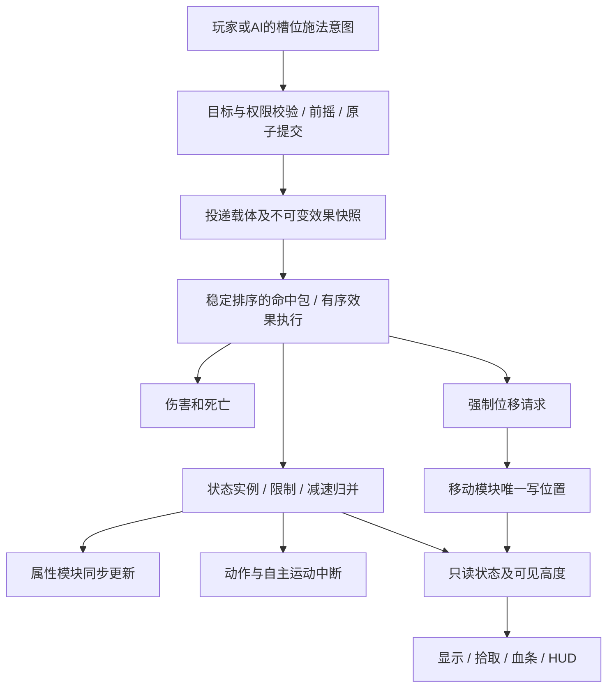

# 技能与状态系统设计

用户已追加授权：完成方案后直接实现，不再等待一次确认。本文件规定本期采用的初始规则；
演示数值与命名属于内容配置，不是商业游戏兼容承诺。需求见 [prd.md](prd.md)，
代码调查及反例见 [research/control-and-effect-seams.md](research/control-and-effect-seams.md)。

## 1. 分层与所有权



| 模块 | 职责 |
|---|---|
| `abilities.rs` | 目标、执行、投递和效果定义；注册完整校验；不含角色/按键分支 |
| 新增 `effects.rs` | 提交快照、命中包、稳定执行顺序；把效果路由至相应所有者 |
| 新增 `statuses.rs` | 状态实例、计时、归并、只读控制权限；对动作/移动发出中断请求 |
| `actions.rs` | 普攻/技能时钟、提交、引导；统一动作中断，不退款已提交效果 |
| `movement.rs` | 普通移动、自主冲刺、强制运动、重生位置；位置唯一写入者 |
| `combat.rs`、`damage.rs` | 命中几何、伤害计算、扣血、死亡/重生与清理编排 |
| `attributes.rs` | 来源更新和最终属性唯一计算；新增实际需要的最终移速系数 |
| `orders.rs` | 校验意图、权限检查、持续目标与追击；拒绝不产生部分变更 |
| `client`、`web` | 只读投影、选择提示和可见姿态；不自行决定免控、打断、伤害 |

保持单 crate、现有公开构造/命令入口和固定步。新增模块仅承载真实的新行为，
不引入通用脚本、插件注册、任意效果递归或多套状态世界。

## 2. 技能定义与执行接口

以下名称作为实现协作的接口基线，内部实现可拆分私有辅助类型：

```text
AbilityDefinition
  name, targeting, range, windup, recovery, cooldown, mana_cost
  execution: AbilityExecution

AbilityExecution
  Impact(ImpactDefinition)
  Dash { speed }
  Channel { duration, interval, pulse: ImpactDefinition }

ImpactDefinition { delivery: Delivery, effects: Vec<Effect> }
Delivery = Direct | Projectile { speed, radius } | Area { radius, delay }
Effect = Damage(DamageSpec) | ApplyStatus(StatusSpec) | Displace(DisplacementSpec)
```

`effects` 必须非空。Dash是施法者自主运动，不是“命中自己”的投递载体。
引导保存同一提交快照，脉冲只负责发出载体；不在每次脉冲重读来源属性。

### 目标与投递兼容矩阵

| 目标 | Direct | Projectile | Area | Dash | Channel |
|---|---|---|---|---|---|
| Enemy（点选单位） | 精确单位 | 跟踪已锁生命 | 提交时冻结目标所在地点 | 拒绝 | 本期不扩展 |
| Direction（方向） | 拒绝 | 沿方向首个敌人 | 拒绝 | 拒绝 | 本期不扩展 |
| Point（地点） | 拒绝 | 本期不扩展 | 冻结指定地点 | 朝地点冲刺 | 本期不扩展 |
| SelfCast（自身锚点） | 本期不扩展 | 拒绝 | 自身位置的敌方范围 | 拒绝 | 复用自身范围脉冲 |

指向表示点选单位，方向弹丸属于非指向；不能混用术语。
本期命中接收者保持敌方过滤，不新增治疗、友方增益或任意阵营组合。
原Q方向弹丸、W延迟范围、E冲刺、R引导均可在新模型表达并保留行为回归。

### 提交与效果顺序

前摇结束重新验证权限、目标生命、射程和资源；整组效果均能构造快照后才一次扣费/进入冷却。
无效组合在注册时拒绝，数值组合溢出在提交前拒绝。命中后不做全包回滚：

- 包内严格按效果列表执行；`[致死伤害, 眩晕]` 的眩晕跳过，`[眩晕, 致死伤害]` 先应用再被死亡清理。
- 0伤害仍继续后续控制；撞墙只终止位移，不回滚此前伤害/状态。
- Direct也只是入队，不允许在动作遍历中立即控制另一单位，避免同tick结果取决于actor遍历先后。
- 命中包用确定的投递阶段、提交序号、载体序号、目标实体排序，包内使用effect_index。
  不承诺跨平台浮点确定性，但不把覆盖顺序交给偶然的ECS查询顺序。

快照保存来源身份、队伍、施法时位置/朝向、技能ID和已算好的伤害/状态参数。
来源死亡/移除不撤销已提交载体和状态；位移方向也不能在命中时重新查询已消失的来源。

## 3. 状态、权限与中断

使用 `StatusSpec` 封闭枚举，避免“眩晕却带减速强度”等非法字段组合：

```text
Stun { duration: StatusDuration }
Root { duration: StatusDuration }
Slow { duration: StatusDuration, fraction }
Airborne { duration: StatusDuration }
```

`StatusDuration` 是正的有界整数tick，提供 `from_ticks` / `from_millis` 构造器。
使用唯一TICK_RATE推导，100ms在60Hz下应为6步；不把0.1_f32扩成f64再ceil为7步。
Slow强度为有限的 `(0,1]`，1表示普通移速归零，但仍不是禁锢：冲刺和操作权限不受影响。

每次应用有实例ID和来源事实。`UnitStatuses` 提供只读状态视图，`ControlState` 提供聚合权限：
`can_move()`、`can_attack()`、`can_cast()`、`can_dash()`，以及是否处于强制运动。
运行态字段受保护，状态结束重新派生权限，不能由某个状态直接把权限改回true。

| 状态/运动 | 步行 | 普攻 | 非移动施法 | 自主冲刺 | 中断规则 |
|---|---|---|---|---|---|
| Slow | 按最终移速 | 允许 | 允许 | 独立速度不变 | 不打断 |
| Root | 禁止 | 允许 | 允许 | 禁止并终止已有冲刺 | 取消移动需求和位移类前摇，保留普攻/普通施法/非移动引导 |
| Stun | 禁止 | 禁止 | 禁止 | 禁止并终止 | 中断普攻前后摇、施法、引导及普通冲刺 |
| Airborne | 禁止 | 禁止 | 禁止 | 禁止并终止 | 同硬控制，仍可被选中和命中 |
| ForcedMotion | 禁止 | 禁止 | 禁止 | 禁止 | 当前运动不被玩家操作或普通控制取消 |

眩晕/禁锢中断自主Dash、但不取消外来强制运动，是本期统一项目规则。
后续有真实技能需求时再加特殊免疫/不中断能力，本期不预建“不可阻挡”系统。

### 意图与取消

- 新Move/AttackMove需要移动权限；新AttackTarget需要攻击权限，Root下射程外目标可保留但不追走。
- 技能需要施法权限，自主Dash还需要自主移动权限；在提交点再次检查。
- 受限的新操作拒绝并反馈，不排队自动重试；被打断的一次施法不在解控后重放。
- 原持续移动/追击保留，解控后重新验证目标、按当前位置重规划；原技能前摇从头重放不允许。
- Stop在控制、冲刺或强制运动中都可清理持续意图/普通路线，不能结束已提交运动或撤销弹丸。
- 控制取消后摇不重置攻击间隔；取消提交前技能不扣费，取消引导只停止未来脉冲，不退款。
- 普攻间隔、冷却和能量回复在受控期间继续推进；暂停才冻结整条固定步。

中断统一经过actions/movement的内部操作，不允许状态系统各自重写计时/位置。

## 4. 固定步与最短控制

所有新状态仅在统一效果末段应用。每步按以下顺序：

1. tick推进、重生、消费公开属性更新。
2. 用当前活动状态与运动锁校验指令、推进动作/冷却、处理持续指令。
3. 普通移动或特殊运动；同一步只执行一种位置预算，完成/撞墙后释放该运动自己的锁。
4. 弹丸/范围收集命中包。
5. 推进并移除**旧状态**，同步更新其权限与属性贡献。
6. 稳定排序并逐项解析本步命中包，应用**新状态**、伤害、位移请求和即时死亡清理。
7. 此后不再补跑一遍动作或移动；客户端读取最终结果。

tick t末应用remaining=N，准确阻止t+1…t+N的动作步，在t+N的移动后到期，t+N+1可行动。
本步新状态不递减；若在下一步指令前就用 `expires<=tick` 清理，1-tick眩晕会从未生效，这是必须回归的反例。
新强制位移也从下一movement步开始。末段所有单位已经提交的攻击/技能依旧有效。

状态应用/到期后必须同步更新属性，不能只入公开AttributeChanges队列等下一步。
属性模块提供模拟内部的校验/提交操作，公开队列与状态模块复用它；客户端没有直接写缓存权限。
旧Slow到期、新Slow同tick命中时允许重算两次，HUD只能读到最终固定步结果。

## 5. 叠加与减速数学

| 种类 | 重施加策略 | 结束行为 |
|---|---|---|
| Stun/Root | 同一来源生命+技能+effect_index刷新到较晚期限；不同来源独立 | 最后一个相应限制结束才恢复权限，时长不累加 |
| Slow | 每次命中独立实例，所有活动实例取最强fraction | 强的到期后较弱但未到期者接替，不能合并“最强强度+最长时间” |
| Airborne | 独立实例，权限取并集 | 显示取各实例连续高度曲线最大值，避免刷新时进度归零掉回地面 |

状态模块仅维护一份私有的最强Slow属性来源，不能将每个Slow都作为负百分比相加。
为“减速30%就是从减速前速度扣30%”这一实际需求，扩展：

```text
AttributeModifier.move_speed_multiplier: f32   // 默认1，有限[0,1]
move_speed = max(0, (base + sum(flat)) * max(0, 1 + sum(additive_percent)))
             * product(move_speed_multiplier)
```

Slow聚合来源写 `1-max_fraction`；20%加速+30%Slow=1.2×0.7=0.84倍基础移速。
其余六项属性沿用当前算法，装备加速仍用现有加算层；不增加未使用的任意属性乘法解释器。
AttributeModifier不能继续派生零值Default，新系数手动默认1；乘法在f64中且在最终f32饱和之前计算。
移除来源从基础值重算，不能除以旧系数恢复（0倍减速也必须正确移除）。

## 6. 生命身份、死亡与重生

实体重生会复用Entity，因此增加私有生命代次，以 `UnitLifeRef(Entity, epoch)` 标识一次生命。
指向目标在接受意图时固定生命引用，提交/跟踪命中再复核；地面区域按命中时的存活单位处理，可合法命中新生命。
状态/位移绑定目标生命，来源引用仅归因，不要求来源存活。

死亡清理通过唯一流程编排：清状态及其私有减速来源、清特殊运动与普通路线、取消动作/持续指令，
再执行既有其它OnDeath属性清理；Explicit属性来源保留。重生增加epoch并重置前后显示位置/控制/高度。
旧控制、旧跟踪目标、旧位移回调不能跨生命生效。

## 7. 强制位移

`DisplacementSpec { distance, speed, direction }` 均注册校验；distance/speed为有限正数。
方向支持沿命中方向、远离命中中心、朝命中中心；拉拽距离不超过到中心距离。
方向所需中心/朝向由载体快照提供，零向量使用提交时朝向回退，不能产生NaN。

Movement将运动区分普通路线、自主Dash、ForcedMotion，特殊运动不与步行预算叠加。
同一几何sweep处理墙体/边界；首次碰撞后结束，不传送到障碍另一侧。
后一个强制请求从当前平面位置替换旧请求，使用运动实例ID区分所有权；结束只释放自己的运动锁。
控制状态和运动锁分开归并：运动结束但Stun/Airborne仍在时，单位仍受限。
贴墙导致零行程时在首个movement步结束，最多保留这一动作步的运动锁；随后按新位置重规划原持续意图。

## 8. 显示、拾取与HUD

战斗位置仍为Vec2，不引入三维导航/垂直伤害距离。击飞显示用活动实例的连续抛物线高度最大值，
高度系数属于客户端表现配置，状态持续与结束由模拟决定。

- UnitVisual根承载平面插值+显示高度；底座用反向局部高度保持在地面，范围圈仍画地面。
- UnitModel仍只负责后摇姿态，不写父根或控制时钟。
- 拾取改读最后已显示的GlobalTransform+Pickable，不能继续使用未插值的UnitPose地面AABB。
- 血条与完整快照screen都从同一实际显示根变换投影；完整快照不覆盖逐帧标签通道。
- 暂停保留已经显示的高度和姿态；死亡隐藏、重生位置与高度清零，避免空中插回出生点。

UnitView增加只读statuses/control信息；状态摘要显示种类/剩余时间，JS不自行判断规则或倒计时。
AbilityView提供目标方式/效果描述与受控可用性，技能名称、图标和操作提示根据装配投影，
不把R写死为自身释放。玩家/选中单位状态在原HUD附近展示，144px无单位属性区保持。
点选敌人技能点击空地/友军保持瞄准且不提交；合法候选提交后退出瞄准，后续拒绝仅提示，不自动重试。
新控制使当前技能不可用时清理瞄准；普通单击/键盘/AI最终均经过模拟校验。

## 9. 迁移与演示

先迁移原Q/W/E/R及65项既有测试，不改变旧定义表达的行为，再按PRD装配控制演示。
默认演示Q点选眩晕、W地点伤害+禁锢/减速、E自主冲刺、R方向击退+击飞；原方向飞矢和引导定义保留。
数据由内容注册，不能在输入/伤害/控制代码中检查具体技能ID或英雄ID。
本期仍用四槽玩家命令；未来装备扩展请求来源/冷却归属时复用提交、投递与效果执行，不能把装备塞进QWER数组。

## 10. 主要风险及控制措施

最短状态失效用精确tick回归；减速数学扩展验证Default=1和饱和顺序；命中顺序显式排序；
复杂控制组合用权限并集而非布尔开关；旧生命引用显式拒绝；击飞用同一个可见姿态贯通拾取和血条。
保留现有引导分数时长/脉冲数量语义，不将每段间隔简单向上取整后累计，避免漏脉冲。
所有规则场景通过公开构造/施法/指令接口测试，客户端显示独立回归，不增加修改World的浏览器后门。
