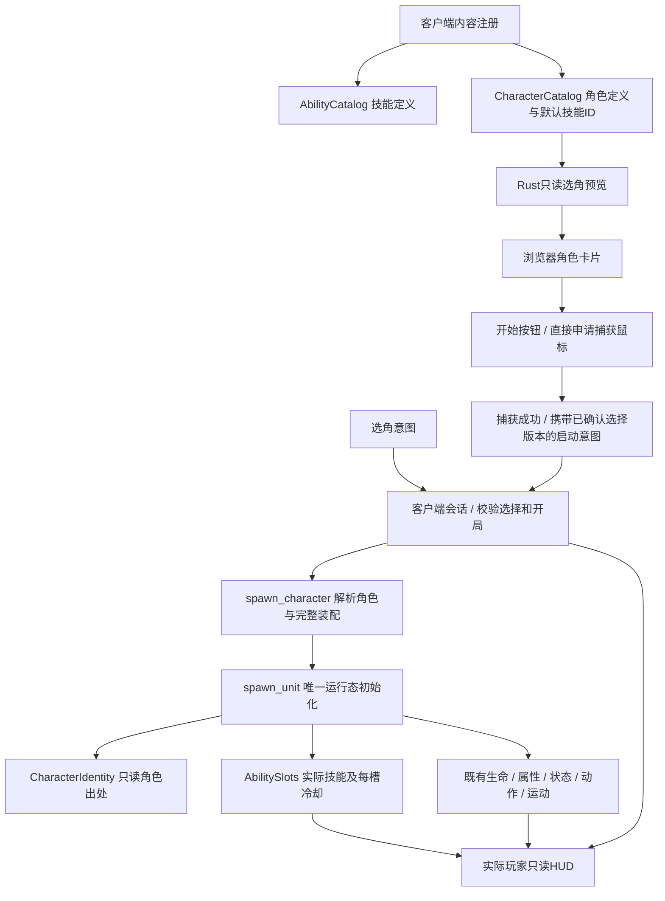

# 角色定义与开局选择设计

本文件是用户已审阅批准的实施基线；用户现已明确要求开始实现。
需求与验收见[prd.md](prd.md)，源码调查见[research/character-and-selection-seams.md](research/character-and-selection-seams.md)。

## 1. 结构与归属



依赖方向继续为client→simulation。模拟不认识DOM、按键、鼠标捕获、UI和角色模型。
角色定义包含技能ID引用，技能规则仍在独立目录；同一技能可被多个角色使用。
角色定义、实际装配、运行状态分别有唯一所有者，见下表。

| 数据 | 所有者 | 不承担的职责 |
|---|---|---|
| 角色名称、描述、初始战斗定义、默认装配 | CharacterCatalog中的CharacterDefinition | 当前血量、冷却、玩家Entity、材质 |
| 实例的角色出处 | CharacterIdentity | 第二份stats、技能或冷却缓存 |
| 本次创建的静态战斗参数 | Unit已有stats快照 | 跟随目录后续变化自动同步 |
| 本局实际四槽技能与冷却 | AbilitySlots | 回写角色默认装配、承载装备主动技能 |
| 生命、最终属性、控制、动作、位置 | 现有对应模拟模块 | 新建CharacterInstance再复制这些状态 |
| 选角阶段与唯一活动玩家Entity | 新增client/session.rs | 重写伤害/施法/重生规则 |
| 选中目标、瞄准 | PlayerController | 第二份活动玩家Entity或开局阶段 |
| 捕获申请的单次pending数据 | 浏览器交互适配 | 判断角色是否已创建、修改基础属性 |

## 2. 模拟Interface

拟新增`simulation/characters.rs`，由`simulation/mod.rs`显式导出。
接口名称作为实施基线；不增加通用模板注册、继承、脚本或角色专属系统。

```text
CharacterId(u16)
AbilityLoadout = [Option<AbilityId>; 4]
CharacterDefinition {
    name: String,
    description: String,
    stats: UnitStats,
    default_loadout: AbilityLoadout,
}
LoadoutSelection = CharacterDefault | Explicit(AbilityLoadout)
CharacterSpawnSpec {
    character: CharacterId,
    team: Team,
    position: Vec2,
    loadout: LoadoutSelection,
    respawn_delay: Option<f32>,
}
CharacterIdentity { private character_id }
CharacterIdentity::id() -> CharacterId
CharacterCatalog::register(id, definition, &AbilityCatalog) -> Result<(), CharacterError>
CharacterCatalog::get(id) -> Option<&CharacterDefinition>
CharacterCatalog::iter() -> ordered readonly entries
CharacterDefinition::initial_attributes() -> Option<EffectiveAttributes>
spawn_character(&mut World, CharacterSpawnSpec) -> Result<Entity, CharacterError>
```

`AbilityLoadout`是定义值的类型别名，置于现有abilities模块，避免model与characters为了别名相互依赖。
`UnitSpec.abilities`可以使用同一别名，原数组调用方式和四槽含义不变。
`CharacterIdentity`字段私有，客户端只读取；不引入一个再次包住全部运行组件的CharacterInstance。
角色ID是内容身份，同一角色可以同时创建多个彼此独立的实例，不以角色ID缓存唯一Entity。

### 注册与原子创建

1. 先注册技能，再注册引用技能的角色。角色目录使用稳定ID顺序，拒绝重复ID。
2. 校验非空名称、合法UnitStats和所有非空默认技能引用；空描述、部分/全部空槽合法。
3. 创建时解析角色及默认/Explicit完整装配，再校验最终技能引用。
4. 构造UnitSpec，复用spawn_unit的出生点、数值、技能及来源分配校验。
5. 成功后在同一次独占World操作内附加CharacterIdentity，再向调用方返回Entity。
6. 任何正常返回的失败都不增加半成品角色、不绑定玩家、不启动模拟，不修改角色目录。

CharacterError集中区分DuplicateId、InvalidDefinition、UnknownCharacter、UnknownAbility{slot,ability}、
InvalidSpawn{reason}；最后一项映射已有spawn_unit失败，不复制其校验实现。
技能引用检查抽为模拟内部单一helper，角色注册/创建与原spawn_unit复用，避免多处校验规则漂移。
不改造所有旧构造错误类型，不为本期引入统一错误框架。

### 实际装配规则

- CharacterDefault：复制当前角色默认四槽，创建后由AbilitySlots独立持有。
- Explicit：完整替换四槽，None表示空槽，不与默认值逐槽合并，也不修改目录。
- 保留现有重复技能ID合法、冷却按槽独立的规则；不暗加唯一性限制。
- 运行时施法/HUD都读取AbilitySlots，不能通过角色ID反查默认技能决定本次行为。
- 本期仅在创建时选择装配，不新增局内换技能、换角色或换装配命令。
- 未来随机模式生成Explicit装配后复用同一入口；本期用公开行为测试验证这条路径，暂不做随机算法/UI。

### 预览数值

选角展示“初始属性”，七项应与没有外部修正时的开局HUD一致。
CharacterDefinition::initial_attributes验证stats后调用属性模块的纯计算入口；
AttributeState::new和它复用同一实现，包含既有攻速归一化，不在client或JS复制公式。
非法stats返回None；已成功注册的角色应始终可获得有效投影。
预览不spawn隐藏单位，不分配属性来源，不伪造UnitView/冷却/当前生命。

### 死亡与重生

既有combat重生只清冷却、不替换技能ID。角色身份、本次stats快照、实际装配跨重生保持。
不重新查询默认装配、不重新抽技能；生命代次递增、控制/运动清理、Explicit属性来源保留沿用现有规则。
同角色的两个实例不共享生命、来源、状态、冷却；NPC继续通过spawn_unit创建，可没有CharacterIdentity。

## 3. 内容装配

拆开当前content::setup中的地图/技能/NPC准备和玩家创建：

- 准备地图、技能目录、角色目录、训练NPC及DemoSettings。
- DemoSettings只保存默认角色ID、玩家队伍/出生点/重生延迟等客户端演示上下文。
- content不再在Web启动时创建旅者，也不写入活动玩家Entity。
- 会话协调器调用spawn_character，成功后才绑定玩家。

建议本期提供两个演示角色，复用现有模型和已有七个技能定义；不新增技能效果或角色独有逻辑。
以下数值是本次方案建议，不是用户逐项指定，也不代表平衡承诺。

| 内容 | 旅者（默认预选） | 秘术师 |
|---|---|---|
| 生命/能量上限 | 600 / 300 | 480 / 360 |
| 能量回复 | 8 | 10 |
| 攻击 / 法强 | 40 / 0 | 30 / 40 |
| 护甲 / 魔抗 | 0 / 0 | 0 / 0 |
| 移速 / 攻速 / 攻距 | 5.5 / 1.25 / 5.5 | 5.2 / 1 / 6 |
| Q | 奥术禁制，点选眩晕 | 奥术飞矢，方向弹丸 |
| W | 震荡领域，伤害+禁锢/减速 | 原震荡领域，范围伤害 |
| E | 流风步 | 流风步 |
| R | 破空冲击，方向击退/击飞 | 共鸣，自身范围引导 |

两者碰撞半径0.45、普攻前摇比例0.275；队伍、出生点(0,6)、重生延迟3秒由DemoSettings提供。
保留旅者原数值/装配作为回归基线；秘术师验证差异属性、方向Q、自身R和实际装配驱动。
角色卡片用文本和现有视觉元素，不额外引入模型/图片资源流水线。

## 4. 会话阶段与暂停

新增client/session.rs，使用小型封闭Resource管理生命周期：

```text
ClientSession
  Selecting { selected: Option<CharacterChoice>, selection_ack, feedback }
  Active { player: Entity, selection_revision: u64 }
CharacterChoice { character_id, revision }
ClientSession::player() -> Option<Entity>
```

每次被接受的Select（包括重复选择同一角色）都递增Rust修订号，供启动请求回显；JS不生成或解释其规则。
选择失败保留上次有效预览/修订，但把最新selection_ack.accepted置false，撤销开始资格，直到新选择被接受。
Active保存唯一玩家引用及最后接受的选择版本；角色身份从该Entity的CharacterIdentity读取，当前生死从UnitState读取。
PlayerController移除player字段，保留selected/aim并在全生命周期存在，避免缺Resource或假Entity。
不再以JS的entered布尔量表示已经开局。

### 固定步前顺序

```text
session::process_requests → controls::collect_input → controls::patrol_units → 既有FixedUpdate链
```

会话请求必须在暂停中也能消费，不使用SimulationControl.paused的run_if阻断它。
客户端Web应用构造时显式暂停；SimulationPlugin自身的默认值保持不变，109项无窗口基线不因此停跑。
session不依赖controls的输入Resource；controls读取会话，继续集中处理运行时暂停和输入清理。
Web客户端构造时设paused=true；Native在Startup自动完成默认创建，保留原初始暂停语义。
新增“有已提交Active玩家”这一前置条件：

```text
Web允许固定步 = Active && 实际文档聚焦 && 实际canvas捕获 && 无暂停请求
```

Selecting时即使DOM误设paused=false或canvas被单独捕获，也不能推进tick/NPC/命令。
每帧排空选择期间的游戏输入和技能请求、清游戏命令队列，不向假玩家提交Stop。
Active暂停仍沿用“清旧队列并提交一次Stop”的行为，恢复时不重放暂停期间的操作。

### 成功开局与捕获

1. 引擎ready后显示Selecting。旅者默认预选，初始无玩家，模拟tick保持不动。
2. 角色卡片发送带关联request_id的选择意图；Rust校验ID，发布对应回执、选择、修订号和初始属性/技能预览。
   开始按钮须等最新选择请求被接受、显示预览与请求角色一致，不能凭旧快照或旧错误提前启用。
3. 点击开始时冻结已确认的角色ID/修订号，禁用选角及重复开始；沿用当前click内直接申请Pointer Lock的已验证顺序。
4. 捕获成功的同一个pointerlockchange回调消费pending快照，先发送Launch意图，再更新捕获/暂停展示信息。
   不把Promise返回或“曾捕获过”当作已开局事实。
5. Rust在固定步前验证Selecting、session.can_start（最新选择回执已接受）、角色/版本、实际捕获及焦点，
   再通过spawn_character创建并一次绑定Active。不能仅靠UI禁用来阻止失败选择后的旧Launch。
6. 确定绑定后才允许固定步。保留GamePointer的居中和just_captured清旧WindowEvent规则，进入按钮点击不变为世界指令。
7. UI看到Rust的Active投影才关闭选角，显示实际单位HUD。

实施验证补充：浏览器可能先更新实际pointerLockElement、稍后才分发pointerlockchange，
两者之间Bevy可以运行一帧。每次申请前撤销旧data-pointer-locked确认，仅事件回调重新确认；
等待通知时不释放实际锁，也不启用GamePointer。controls在已确认且未暂停时才同步捕获，
确保开始/恢复确认当帧保留just_captured；已确认但无有效Launch的捕获仍释放。
此补充修正浏览器适配时序，不改变选择资格、实际捕获/焦点校验或唯一玩家所有权。

### 失败、重复与恢复

| 情形 | 结果 |
|---|---|
| 捕获拒绝/错误 | 不发送成功Launch、不创建玩家；保留选择，显示重试 |
| 捕获后、Rust受理前失焦/释放 | Launch拒绝，保留Selecting；无部分绑定 |
| 未知角色/过期修订/无匹配选择 | 保留原已确认选择，反馈并释放本次捕获，不退回隐式默认角色 |
| 出生点被阻挡/创建失败 | 无玩家、无半成品，保持选角并反馈 |
| 双击/重复Launch/重复捕获通知 | Active阶段不再创建；不清生命、技能、冷却或场景 |
| Selecting状态的单独捕获 | 不自动开始；释放不带有效Launch的捕获并保持暂停 |
| Active的Esc/失焦/丢捕获 | 只暂停；选角面板保持关闭 |
| Active恢复 | 只重新捕获/解暂停；不发送初次Launch，不重建玩家 |
| 玩家死亡/重生 | 仍为Active，同Entity与实际装配，不回到选角 |
| 局内选角意图 | 拒绝，不改变玩家与世界 |

首版不提供重开入口的限制已由下方用户补充覆盖；局内即时切人仍不提供。
不把“恢复试炼”实现成隐式清场/创建新玩家。

### Native兼容

主要选角体验在Web。Native保留编译/运行，在Startup通过相同角色解析/创建路径自动采用默认旅者，
不等待不存在的DOM或Pointer Lock，也不新增一套native选角UI。
Native活动玩家同样归ClientSession，是否运行仍由现有焦点/暂停逻辑决定；
平台捕获/焦点事实作为小型输入值传给协调函数，便于无GPU测试，不引入唯一实现的trait框架。

## 5. 浏览器协议与只读投影

使用三类封闭意图，浏览器不能提供stats、技能数组或运行态：

```text
SelectCharacter { character_id, request_id }
Launch { character_id, selection_revision }
ReturnToSelection { player_id: String }
```

request_id只是浏览器生成的u32关联值，由Rust在selection_ack中回显；角色选择revision仍只由Rust生成。
初始预选对应request_id=0的已接受回执；手动选择使用正的request_id。
Web桥接复用现有DOM数据通道，按序消费并移除；小型队列上限32、先完整解析/校验结构再执行。
超限/非法结构的批次拒绝并清除，避免处理一半Launch后又因结构错误失败。
结构有效后每条语义请求独立执行；语义失败不回滚之前已接受的选择，拒绝Launch不产生角色。
若有效Launch已提交为Active，后续无效Select只被拒绝，不撤销玩家或重置场景。
选择与启动分开：快速Select(B)后旧Launch(A,rev)不能误创建A。
UI仅在selection_ack匹配最新request_id且accepted=true、预览角色匹配且无捕获申请时允许开始。
失败选择不隐式回退/启动旧角色：已有A/rev1后，Select(未知B)再收到Launch(A,rev1)必须拒绝。
再次接受Select(A)会产生新修订，旧Launch仍失效；有效选择回执可以被后续捕获或创建失败保留，允许重试。
开始捕获期间UI禁用选择；pending只属于本次捕获，失败/取消清除，晚到的旧回调不得清较新的请求。
这只是选择、开局及返回的封闭适配，不扩展成通用命令总线或跨层事务框架。

重新选择使用第9节的ReturnToSelection：结束当前局并丢弃该批次剩余意图。
SelectCharacter由当前选角界面同步发送，不携带局代次；若未来引入跨局异步传输，需要另加上下文标识。

完整HudView保留原字段，增加session投影，并允许player_id为null：

```text
player_id: null | EntityString
session: {
  phase: "Selecting" | "Active",
  selection: null | {
    choices: [{ id, name, description }],
    selected: null | { id, name, description, max_health, max_mana, attributes, abilities },
    selection_revision: null | u64,
    selection_ack: { request_id, accepted },
    can_start,
    error
  }
}
UnitView.character_id: null | CharacterId
```

Selecting的player_id=null、运行时abilities=[]；selection.preview不占用UnitView。
Active的selection=null，不在每次HUD更新重复发送整份角色预览；实际UnitView/AbilityView保持原含义。
选择/开局/错误变化强制一次完整快照，正常Active继续80ms限频，逐帧labels只发送真实实体显示坐标。

`client/abilities.rs`抽出无实例依赖的技能元数据投影，选角和实际技能视图共用名称/图标/目标/描述。
实际AbilityView继续叠加冷却、权限、能量等运行信息，保留现有扁平JSON字段兼容性。
初始属性仍由核心纯计算投影，JS只格式化数字，沿用七项短标签且不显示单位。

## 6. 选角界面

复用entry覆盖层：Selecting显示角色卡片和当前预览，Active暂停只显示继续试炼。
默认旅者预选，角色卡片包含名称/简短定位；右侧或下方预览生命/能量上限、七项初始属性及四槽技能说明。
开始按钮在有效选择、最新回执匹配且无捕获申请时可点击，等待Rust确认选择期间不能拿旧预览开始。

保留#enter、#pointer-error等入口；新增#character-select、[data-character-id]、[data-preview-stat]，
预览选择器不占用实际HUD的[data-stat]。卡片用原生button、Tab/Enter操作、明确选中态和可读标签。
选角/等待/失败阶段都在data-ui内，操作不会穿透成移动、攻击、施法或相机平移。

在1280×800可并列卡片与预览；800×600重排，面板内可滚动，开始按钮保持可达。
1000×720 DPR2及窗口缩放采用同一CSS像素约定，不新增独立输入坐标。
实际对局仍保留144px七项无单位属性区；选择前隐藏实际玩家HUD，避免写死旅者数值闪现。

## 7. 修改边界

| 路径 | 必要原因 |
|---|---|
| simulation/characters.rs（新） | 角色定义、目录、身份、装配解析、统一角色创建 |
| simulation/abilities.rs / mod.rs | 共享装配别名、角色接口导出和目录初始化 |
| simulation/attributes.rs | 提取已有纯初始计算供构造和预览共同使用，不改公式 |
| simulation/model.rs | 必要时将原数组标注替换为同形别名，不更改运行态归属 |
| client/content.rs | 拆玩家创建、注册两角色及DemoSettings |
| client/session.rs（新） | 阶段、选择校验、原子开局和唯一玩家引用 |
| client/controls.rs / mod.rs | 会话先于固定步、无玩家输入清理、活动玩家查询 |
| client/camera.rs / scene.rs | 处理合法无玩家阶段，保留实际显示根/血条/拾取语义 |
| client/ui.rs / abilities.rs / web.rs | 纯预览、可空player_id、意图适配、动态视图复用 |
| index.html / web/hud.js / style.css | 开局选择、捕获pending、失败/恢复分支及响应式布局 |
| tests/characters.rs（新）/客户端测试/浏览器脚本 | 核心装配、会话边界、端到端选角及既有109场景回归 |
| docs/architecture.md / Trellis规范 | 只在实施验收后回写已落地约定 |

核心战斗、控制、运动、伤害和重生语义保持；除验证暴露真实依赖外，不计划重写actions/combat/statuses。
不新增依赖、资产系统、任意数量技能槽、角色ID战斗分支或装备占位框架。

## 8. 风险和处理

最大风险是捕获成功早于角色创建、输入积压、恢复误重建、无玩家调用者遗漏、预览与最终属性不一致。
分别由唯一会话/Active门控、选择阶段排空、阶段校验、逐调用者迁移、共享核心计算及对应行为测试约束。
选角模型会触及多个client文件，这是表示合法“尚无玩家”所需的集中迁移，避免用占位Entity隐藏该状态。

回退按完整切片恢复，不能只恢复旧HUD或旧PlayerController字段而保留半套新生命周期。
不改备份分支、不清空工作区；保留旧公开spawn_unit和默认旅者路径，定位失败时用公开构造回归对照。

## 9. 用户补充：整场重开后的重新选角

行为已由用户确认：暂停菜单重新选角会重开整场试炼，不保留NPC战斗状态，不刷新页面。

变更边界：
- simulation公开一个清理本局运行态的入口；只清单位/弹丸/范围、待执行队列/事件及模拟tick并暂停。
  保留NavigationMap、技能/角色目录、属性来源与效果/状态序号分配器的单调性；不回收同World中的来源ID。
- content提取训练NPC创建，初次准备和重开复用相同内容配置，不重跑目录注册或静态场景搭建。
- ClientSession继续唯一拥有玩家和阶段；增加带当前玩家Entity字符串的ReturnToSelection意图，
  仅暂停/已释放捕获时接受，并匹配当前玩家。Selecting重复返回无副作用，旧玩家返回不影响新玩家。
  会话保留跨阶段单调的选择版本，不用setup重置到rev1；返回时清理旧局并预选上次角色，下一Launch仍核对版本/真实捕获。
- controls在无玩家边界清目标/瞄准/指令/反馈，camera在Selecting复位；保持session不直接依赖输入资源。
- DOM仅提交返回意图，等Rust投影再显示选角；Active→Selecting清本地选择关联及旧捕获attempt，采用Rust新的预选/修订。
  暂停菜单按钮说明会重置本局。返回处理进行中禁用重复操作；不使用location.reload或直接修改World。
- UI视图清除已不存在的玩家/目标/标签；静态地图、camera实体和场景资源只创建一次。

验证：公开模拟清理场景覆盖尚存弹丸/延迟区域/修正队列、身份不复用；会话覆盖损伤后重开、旧版本和旧返回拒绝；
浏览器真实Esc→重新选择→切角色→再次捕获，验证tick0、旧单位消失、新HP/装配与输入隔离，小窗口/DPR2可达。
