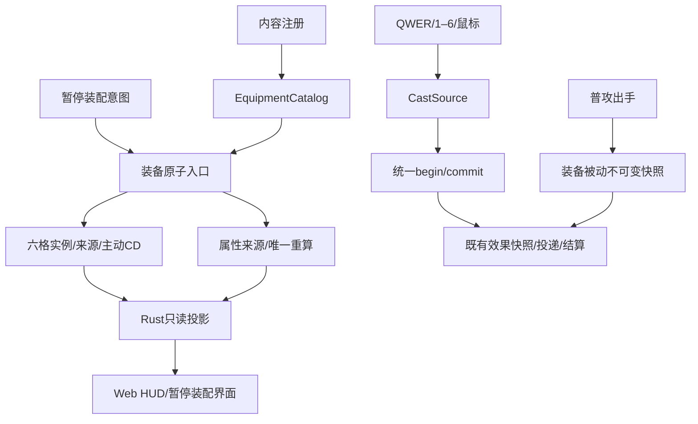

# 六格装备设计

## 1. 所有权与数据流

client→simulation依赖不变。装备目录只存定义；EquipmentSlots保存每单位六格实际实例和主动CD；
属性模块唯一计算最终数值；actions/orders唯一处理施法生命周期；effects/combat/statuses/movement继续拥有各自规则。
装备管理是核心的显式原子入口，客户端只在暂停中提交ID/格/实例意图，不传任意属性或技能。



## 2. 核心Interface

```text
EQUIPMENT_SLOTS = 6
EquipmentId(u16)
EquipmentInstanceId(private ModifierSourceId) : Copy + Eq + Display
EquipmentDefinition { name, description, flat:AttributeDelta, additive_percent:AttributeDelta,
                      passives:Vec<EquipmentPassive>, active:Option<AbilityId> }
EquipmentPassive::OnBasicAttackHit { name:String, effects:Vec<Effect> }
EquipmentCatalog::register(id, definition, &AbilityCatalog) -> Result<(), EquipmentError>
EquipmentCatalog::get / iter (ascending ID)
EquipmentSlots::item(slot) -> Option<&EquippedItem>
EquippedItem::equipment() / instance() / cooldown()
equip_equipment(&mut World, unit, slot, EquipmentId) -> Result<EquipmentInstanceId,EquipmentError>
unequip_equipment(&mut World, unit, slot, expected:EquipmentInstanceId) -> Result<(),EquipmentError>
UnitCommand::UseEquipment {slot,instance,target}
CastSource::AbilitySlot(usize) | EquipmentSlot {slot,instance}
```

`EquipmentSlots`默认空，随spawn_unit附加，不改变UnitSpec/CharacterDefinition字面量构造。
每件实例复用AttributeChanges分配的唯一来源作内部ID；只给来源模块增加pub(super)数值读取供Display，
不公开ID构造、Debug协议或第二套全局分配器。字符串ID用于DOM，Rust从当前格比对后取typed handle。
注册校验平面/百分比均有限、非空名称及合法effects/主动引用；属性来源内部固定Explicit、move_multiplier1。
错误区分目录重复/非法定义/未知主动、单位/格无效、占用/空格、旧实例、来源耗尽。

装卸先完整校验，来源分配为最后可失败步骤；同步调用属性模块set_immediate，保证暂停中的HUD也真实更新。
不把变化排到暂停期间不运行的固定步；不绕过属性唯一计算。不隐式替换、不清其它装备或无关动作。
允许相同装备按实例叠加，主动CD按实例独立；新装备从0CD开始，源ID不回收。

## 3. 统一主动施法

保留CastAbility与AbilitySlots四格。UseEquipment带实例身份，两种命令进入同一个begin_cast和commit_cast，
完整复用已有目标/生命/权限/忙碌/资源/整组快照校验、消耗、恢复、冲刺和引导，不复制第二条技能分支。
UnitAction::Casting以source:CastSource替代slot，保留ability；Channeling保持形状，其pulse.origin已保存装备实例，
不再复制来源字段。装备在提交前复核当前格/实例/定义/CD；所有校验成功才扣费/启该来源冷却。
正常AbilityCommitted事件继续体现实际复用的技能；伤害来源完整区分装备实例。

DamageOrigin增加EquipmentActive{equipment,instance,ability}和EquipmentPassive{equipment,instance,passive}。
状态Stun/Root刷新键改为来源生命+完整origin+effectIndex，原ability getter兼容；不能把多个装备的None/同AbilityId合并。
卸下通过actions内部helper取消同实例Casting及Channeling后续脉冲，保留已提交弹丸/范围和自主冲刺。
装备active时钟单独由装备模块在固定步更新，含死亡单位；重生不清其CD，暂停run_if冻结全部。

## 4. 被动是受限的一层实际触发

首版只实现OnBasicAttackHit，无内部CD或可编程触发器。普攻出手前按格/被动索引快照全部装备effects，
如任一伤害快照无效则本次出手不提交攻击间隔，保持原子性。不可变被动快照附在该普攻payload。
命中先结算普通攻击；只有实际正损血且目标仍是活的同一生命，才依稳定顺序解析附属快照。
附属效果复用现有Damage/Status/Displace解析，不进入新的触发发现过程；禁止递归，也不监听宽泛Damaged总线再派发。
技能/装备主动/被动伤害不产生普攻被动。已提交的附属快照不查询实时背包，卸装/来源死亡后仍随载体有效。
致死后按既有生命引用规则跳过后续效果，来源生命/实例/被动索引保留归因。

## 5. 生命周期与管理适配

死亡保留装备/Explicit属性，装备CD继续随固定步倒计时，重生不刷新；普通暂停恢复保留全部状态。
reset_simulation随Unit清六格与来源，装备目录静态保留；新局全空，不复用实例ID。
训练场面板只允许当前Active玩家、暂停且实际无鼠标捕获，死亡时也可调整持久装备。
client/equipment.rs拥有封闭管理意图和回执，只调用核心装备入口；顺序在session请求之后、collect_input之前。
Return成功后旧装备请求在Selecting拒绝/消费，不可作用到新玩家；清理/重开不重复注册目录。

```text
Equip { player_id:String, slot:usize, equipment_id:u16, request_id:u32 }
Unequip { player_id:String, slot:usize, instance_id:String, request_id:u32 }
```

JSON队列data-equipment-requests最多32条，严格字段，整批结构先验证、语义FIFO。UI每次等待对应回执后解锁，失败保留原格/属性。
缺字段/非法值也有回执错误，不能让前端永久pending；同玩家/实例身份作为失效边界。

## 6. 只读投影、输入和布局

提取无slot的AbilityDescription，共享技能说明；原AbilityMetadata/AbilityView继续保持原扁平字段。
装备目录active用无slot说明，实际六格active使用真实格index+CD/权限视图，不伪造角色QWER。
HUD增加equipment{slots[6],first_empty_slot,can_manage,ack}、equipment_aim；原aim仍仅英雄技能数字，abilities仍四格。
equipment_catalog仅首次成功完整快照发送，之后null；JS保存只读目录缓存，不在每80ms重复整个静态目录。

输入复用select_cast/submit_cast：Aim保留AttackMove/Ability并增加携带实例的Equipment；外部UI仍区分角色/装备。
1–6选择/自身直接释放，鼠标点击实际HUD同等可用；控制/失焦/暂停/重开清过期瞄准。
DOM装备使用意图独立于data-skill，统一在just_captured/no-player/paused边界排空，防旧点击重放。
scene和HUD从相同CastSource解析当前定义，复用范围、指向、地点/单位提示，不按ItemId决定规则。

装备六格2×3紧凑排列在原hero-hud右侧，现有144px七属性保留；小窗口隐藏portrait、调整间距，不靠压缩文案解决溢出。
地图在需要时移到HUD上方，保留原可见/无重叠断言。装备按钮用独立data-equipment-slot，不复用.hero技能选择器。
P或暂停菜单打开专用装配overlay，暂停并释放捕获；六格/可卸下操作及目录卡片可滚动，关闭回暂停菜单，继续试炼才重新捕获。
面板装备到Rust投影的首个空格，满格禁用并提示；不做拖拽/商店/合成。说明来自Rust，JS只格式化和渲染。

## 7. 修改边界与风险

- 新simulation/equipment模块拥有目录/实例/时钟/装卸/被动收集；不拆成管理器、事件插件或脚本引擎。
- model/orders/actions/damage/effects/statuses/mod仅为来源复用和必要生命周期接入；combat只保留装备CD跨重生规则。
- client/equipment新适配+abilities元数据提取；controls/scene/ui/content/mod/web最小接入，session重选接口保持。
- index/web与browser-equipment覆盖新UI，旧138测试与原浏览器断言保留。
- 重点验证来源误合并、卸装后提交、快照溢出、暂停装卸投影、角色/装备CD混淆、被动递归及UI溢出。
- 回退以整个装备纵向切片为单位，不删除用户代码、不改变备份分支。
