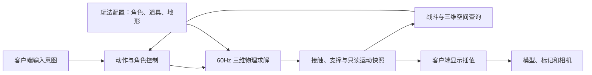

# 三维物理迁移设计

本文件为已审实施设计，需求与验收以 [prd.md](prd.md) 为准。用户于 2026-11-09 在包含小山的最终摘要之后明确回复“开始实施”。

## 1. 选择与边界

采用 Avian 0.8 的三维刚体、接触求解、连续碰撞和空间查询，替换当前二维扫掠与独立高度积分。角色采用可控制且保持直立的动态胶囊，箱子为自由转动的动态刚体，地面 / 石柱 / 石块 / 坡道 / 小山为静态刚体。

- Avian 与现有 Bevy ECS 使用一致的实体 / 组件模型，官方版本表为 Bevy 0.20 ↔ Avian 0.8。
- 最小依赖拟为 `avian3d = { version = "0.8", default-features = false, features = ["3d", "parry-f32"] }`；不默认引入渲染调试、picking、场景加载和并行能力。
- 原生和 WASM 使用同一套物理规则；模拟模块不依赖窗口、浏览器、相机或渲染 Mesh。
- 初始重力保留当前沿 -Y 的 18m/s²，作为统一物理世界的玩法参数；角色和箱子不再各自重复积分重力。
- 动作和伤害规则继续属于项目自身，物理引擎负责运动、接触、支撑和场景查询。

官方依据：[版本与集成](https://github.com/avianphysics/avian#version-table)、[Avian 0.8 API](https://docs.rs/avian3d/0.8.0/avian3d/)。具体调用、调度和暂停边界记录在 [物理接入研究](research/avian-integration.md)。

## 2. 唯一状态来源

### 物理实体

- Avian 的位置、转动及线 / 角速度是物理权威；项目不再并行积分另一份高度或把另一份水平位置写回物理。
- 角色胶囊以几何中心定位，脚底锚点由中心减去当前胶囊半高得到。蹲伏改变半高时保持脚底连续，并在扩大前检查净空。
- `Body` 作为项目只读门面缓存前一 / 当前的三维脚底位置和实际速度；只有物理桥和受控出生 / 复活流程能更新。快照不能成为第二个位置求解器。
- `MotionState` 保留动作、跳跃额度和当前支撑元数据，删除独立重力、地面高度归零及火炮解析曲线直接写位置等旧权威行为。
- 复活同时恢复权威姿态、速度、动作及显示快照，不能只修改旧 `Body` 缓存。

### 显示实体

- 客户端显示根与物理实体分离，以 owner 关联。角色、箱子和地形装饰均从其拥有者读取姿态。
- 现有 `scene::sync_player` 不能再对物理实体的 `Transform` 写显示插值；否则 Avian 的 Transform 同步可能把表现写回模拟。
- 角色显示使用脚底锚点，箱子显示包含物理转动。箱体上的绑带等装饰挂在同一显示根下，不能停留在出生点。
- 相机继续跟随同一份已插值脚底位置，保留当前俯视角与身体在屏幕下三分点的构图；暂停取当前快照。

## 3. 固定步和暂停

将物理配置到现有固定步的明确系统组中，逻辑顺序为：

1. 采样和锁存后的动作意图转换为运动目标、姿态变更及一次性冲量。
2. 执行 Avian 物理步和碰撞求解。
3. 计算支撑、相对速度、接地转换及三维只读快照。
4. 用当前三维结果结算战斗、冷却和后续冲量；当步产生的战斗冲量在下一个物理步生效，保持原有动作 → 战斗时序。

Avian 使用 `PhysicsPlugins::new(FixedUpdate)` 接入。读取组件化 ShapeHits 时，支撑发布必须在本步 `SpatialQuerySystems` 完成后执行，不能简单放在仍早于查询刷新的 `PhysicsSystems::Last` 中；直接空间查询也需验证已读取本步的 collider tree。

`SimulationActive` 同时控制动作、物理求解、支撑 / 快照发布、战斗和 AI。对 `PhysicsSystems::StepSimulation` 共同加条件门控。暂停不能只调用引擎时间的 `pause()`：必须阻止暂停首步执行带旧 delta 的求解，详见接入研究。暂停期间不累计重力 / 冲量；输入失活清理仍保留到恢复后的首个动作步执行。

显示层继续独立插值，不能与引擎的 Transform 插值叠加两次。

## 4. 角色控制与支撑

- 胶囊锁定横滚 / 俯仰，朝向由既有 Facing 控制；不把角色做成自由翻滚的箱体。
- 地面接触必须位于脚底附近，法线满足可行走坡度，且角色没有以正相对速度离开表面。墙面、头部接触和上升途中的旧接触不能恢复跳跃额度。
- 接触查询包含休眠支撑，不能只遍历 active 接触导致箱堆休眠后丢接地；对子 Collider 的命中应解析为其所属刚体。
- 起步坡度上限拟为 45°；这是控制器参数，实际手感验收可微调。可行走地面上的目标方向投影到支撑切平面并归一化，保持沿表面的目标速度一致。
- 支撑跟随考虑接触点速度，包含箱子的线速度与转动贡献。无输入时不强制世界水平速度为零，以免抵消脚下箱子的运动。
- 离开平台边缘立即失去支撑并由重力下落；只在接触规则确认落地时恢复跳跃次数。
- 二段跳沿用两次额度与 6.4m/s 起跳速度；地面起跳计入支撑运动，空中二次起跳重新提供向上速度，第三次消费后忽略。
- 闪避 / 疾跑 / 滑铲仍保留既有时间、方向和触发语义，但通过控制目标或冲量推进胶囊；被实体阻挡时按求解结果停止或滑动。
- 静止、行走、空中和陡坡使用明确的接触 / 摩擦策略，避免粘墙、下坡不断弹跳或电梯式爬上陡壁。
- 高速动作开启适当 CCD / 子步进；Avian 0.8 默认 swept CCD 不覆盖 Dynamic，须显式选择包含动态箱子的过滤集。实际阈值和子步数由穿透回归和 Web 性能共同验证。

## 5. 箱子与固定场景

- 每个箱子为独立实体，尺寸来自当前 Prop 数据，质量和摩擦按统一配置生成。允许重力、平移、旋转、休眠和受力唤醒。
- 箱子接触角色时传递有限作用，武器对箱体的有效命中可施加受控冲量；不新增碰撞伤害或箱子破坏规则。
- 堆叠与支撑由实际接触结算，承托箱子被推出后上方箱子和角色随支撑变化运动。
- 地面、石柱和石块保留固定属性，碰撞尺寸与主要可见几何一致；装饰不重复生成穿插的碰撞体。
- 周边现有 0.7m 围墙使用真实体积，不保留不可见的无限高平面钳制。越过边缘后由重力下落，达到场景回收高度时走既有复活 / 状态清理流程，重置物理和显示快照。
- 移除依赖出生时二维 `CollisionWorld` 的旧静态权威，三维查询始终针对当前物理世界，箱子移动后的旧位置不能继续遮挡。

## 6. 非平地测试区

地形由玩法生成确定性的顶点 / 三角形数据。客户端据此生成可见 Mesh，模拟据此生成静态 Collider，二者使用相同局部坐标、缩放及世界姿态。

### 规则坡道与高台

- 一段约 20°、足够角色双向行走的坡道，从平地连续连接高台；高台保留可测试下落的开放边缘。
- 顶面、侧面及平台均有真实几何；坡脚和坡顶接缝不留碰撞缝，也不人为添加能被当成台阶的凸边。
- 放置提案：坡道 `x∈[-6,-3]、z∈[1,5.1212]`，从 y=0 升到 1.5m；同宽平台继续延伸至 z=8.1212。由出生区西侧沿平地抵达坡脚。
- 具体几何推导和净空依据见 [地形与调用方研究](research/terrain-and-callers.md)。

### 小山

- 在庭院空闲区域生成一座小山，包含平滑衔接平地的山脚、可步行缓坡、山顶、下山路径和一侧超过坡度上限的测试坡面。
- 采用紧支撑连续高度函数及确定性网格采样，不依赖运行时网络素材，不用叠箱子代替山坡。
- 起步提案：山顶高约 2.6m，西侧缓坡半径约 5.5m、东侧较陡半径约 3m，南北半径约 4.5m。山脚高度与平地一致，山脚与山顶一阶变化连续。
- 放置提案为庭院东侧，山顶约在 `(16.5, 0, 8.5)`，足迹约 `x∈[11,19.5]、z∈[4,13]`。实施前自动验证与既有 Prop、出生点和坡道不重叠。
- 用简洁的地表色差和网格 / 等高提示帮助辨认坡度，不引入新的美术风格或操作模式。
- 初始约 0.5m 网格覆盖平地与小山，使用一份连续地表三角网格，避免小山底部与旧平面重叠碰撞。坡道 / 高台可另用真实实心几何；跨 Collider 的接缝必须通过行走回归，不能假定内部边修正会自动消除。
- 动态箱子使用凸箱体；静态地形三角网格按真实连续碰撞进行验证。加密地形网格只在外观或接触测试需要时进行，并测量 WASM 成本。

## 7. 战斗与落点查询

- `Combatant::aim` 与目标快照迁为三维世界位置。火炮落点从前方候选区域投射到当前可承托表面，保存命中点和表面法线。
- 火炮跃进使用受物理约束的发射 / 运动控制，避免解析曲线直接把人物放进障碍；落点承诺和联动窗口仍由既有规则管理。承托表面被移走时按实际接触落地。
- 锁定和命中范围使用三维几何，遮挡使用实际攻击 / 观察起点到目标的空间查询。命中扫描、近战范围与区域技能保持各自原有攻击类型。
- 锤子击飞 / 狙击和火炮跃进 / 旋斧保留有效窗口与一次消费契约；角色站在箱顶属于接地，不能误判为仍被击飞。
- 目标圈、瞄准圈、落点标记和防御提示不能继续固定在世界 y=0.05；应放到支撑表面并按法线定向，偏移少量距离避免闪烁。
- 敌人追击沿地面控制器推进，使用同样的支撑与坡度规则；不在本次引入新寻路系统。
- 移除敌人攻击中 `target_motion.height() < 1.1` 一类绝对海拔条件，改为相对三维攻击范围；同站山顶的双方必须能够正常交战。

## 8. 文件与责任边界

| 范围 | 预计改动与目的 |
|---|---|
| `Cargo.toml`、`Cargo.lock` | 锁定兼容的 Avian 依赖和最小特性 |
| `src/simulation/mod.rs`、新增物理桥模块 | 配置固定步顺序、暂停、实体装配与空间查询 |
| `src/simulation/actions.rs`、`movement.rs` | 控制器、三维快照、接地 / 支撑与动作适配 |
| `src/simulation/geometry.rs` | 替换旧二维碰撞职责，必要的几何类型保留为配置或测试辅助 |
| `src/gameplay/mod.rs`、必要的地形模块 | 可移动道具、静态场景、坡道及小山的确定性配置与装配 |
| `src/simulation/combat.rs`、必要的 weapons 适配 | 三维目标、遮挡、命中、冲量及跃进契约 |
| `src/client/scene.rs`、`combat.rs`、`controls.rs`、`animation.rs`、`stickman.rs`、必要的 `camera.rs` / `hud.rs` 适配 | 纯显示根、箱体旋转、地形 Mesh、表面标记、空中 / 接地状态及相机跟随 |
| 上述模块的测试及必要浏览器验证脚本 | 物理 / 地形 / 现有玩法回归与可重复验收 |
| `README.md`、`docs/architecture.md`、相关 `.trellis/spec/` | 实施落地后记录新契约和测试方式 |

实施时仅修改真实受新接口影响的调用方，不以本表为理由改动无关客户端代码。

本任务有意替换当前规范中的二维 Body / sweep、零高度接地、独立高度积分和静态 Prop 遮挡等契约；这些条款不能被检查代理作为将实现改回二维的依据。既有意图锁存、事件归属、暂停清理、几何同源和单向依赖约定继续有效，落地后再同步规范。

## 9. 风险与控制

- 动态角色的稳定性与手感需要调参：先验证一个胶囊、一个箱子、一段坡面，再迁移完整场景。
- 箱子堆叠、斜坡接缝和高速运动可能放大数值误差：用固定输入回归验证，并限制初始几何复杂度和活跃刚体数量。
- 地形三角形的绕序、法线和采样误差可能造成看见与踩到的位置不同：共用几何并加入坡度 / 边界 / 法线回归。
- 物理实体和显示实体分离容易影响武器挂点、actor 事件归属和 UI 引用：保留 owner 映射并跑现有骨骼 / 战斗回归。
- 原生通过不代表 WASM / WebGPU 手感通过：必须单独检查 WASM、入口构建和真实浏览器表现。
- 当前工作区已有已验收功能：实施分段保留基线，不重置、清理或覆盖整个文件；回滚只撤销本任务新增内容。
