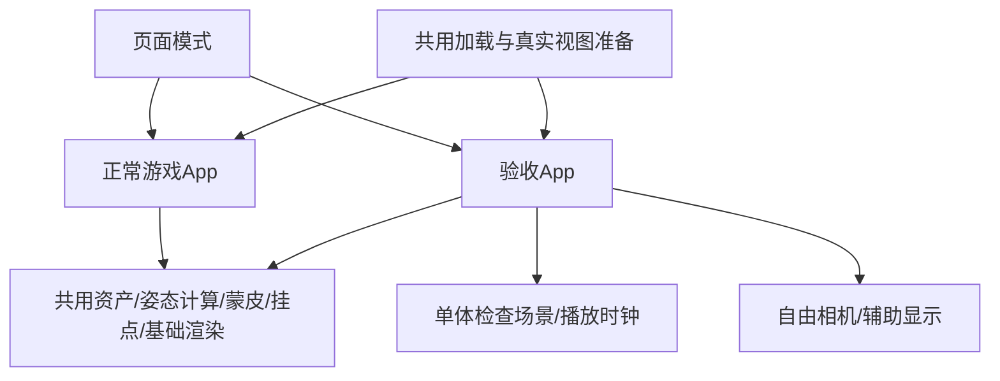

# 模型、武器与动作验收页技术方案

本文为已获批的实施方案，不是已实现规范。需求与验收以[PRD](prd.md)为准。

## 1. 页面定位与布局

默认进入“游戏表现检查”，以当前运行资产／真实配置／同一动画计算为准。另设“源片段对照”，用于分辨源动作与Kiva裁剪、混合、IK后的差别。

```text
┌──────── 模型／武器／动作验收 ─────── 返回游戏 ┐
│ 实际配置预设 │                           │ 检查辅助 │
│ 角色／武器   │       中性背景 3D 视口       │ 骨骼/握点│
│ 游戏动作     │     自由环绕、缩放、平移      │ 部件显隐 │
│ 或片段目录   │                           │ 来源信息 │
├──────── 播放/暂停/重播/步进/倍速/循环 ────────┤
│ 时间轴 ━━━━━━━━━━━━━━━ 当前时间／预览帧     │
└──────────────────────────────────────────┘
```

- 左侧：实际游戏配置预设、三个外观、当前五武器／无手持、动作或片段搜索／分组列表。
- 中间：固定地面／网格和中性灯光，避免竹林遮挡；保留实际PBR／蒙皮，光照不同不会承诺像素同色。
- 右侧：网格／轴／骨骼／握点／枪口／包围盒开关；按实例部件显隐；当前主片段、采样时间、过渡／IK等实际适配信息；复制检查信息。
- 底部：播放、暂停、重播、前后一步、0.25/0.5/1/1.5/2倍、循环、可拖时间轴。游戏模式步长1/60秒；不能称为源关键帧步进。

## 2. 入口与运行组合

推荐 `http://localhost:3221/?view=model`，静态子路径为 `https://host/kiva/?view=model`。保留同一index与WASM，现有Trunk一次构建／静态发布命令不变。只识别明确的view=model值，其余进入原游戏。

模式在创建Bevy App前固定。浏览器UI与Rust取得同一只读模式；整页链接切换游戏／查看页，不在首版运行中反复销毁整个App。



验收App不注册SimulationPlugin、gameplay/scene/combat/companion整套编排、游戏animate查询系统、controls、camera::follow、HUD、BGM。它只创建检查对象、地面、灯光、相机、目录与播放控制，再调用共用显示实现。
Web游戏input/hud/enemies/appearance/audio在查看模式必须于注册监听器前退出，不能只是CSS隐藏。查看页不要求点击捕获鼠标，使用pointer capture拖动；共同startup/loader保留真实加载反馈。

## 3. 共享实现和一致性约束

| 共用部分 | 现有接口／计划改动 |
|---|---|
| 角色与缓存 | 复用avatar spawn/replace/sync、AV02/AV03及各自参考/IBM；普通显示根，不加ActorView/Body |
| 武器 | 复用四槽WeaponModel和愁铃客原刀显示；目录封装差异，不能对白灵淼直接调用缺blade的包接口 |
| 最终姿态／挂点 | 在avatar内抽共用求值，给出实际palette、左右手、脊柱与挂接frame；保留现有右手结果，补齐源动画左手／spine，所有路径共用 |
| 近战 | 保留现有手腕轴校正和+0.055m挂点，武器握柄0/+Y；辅助显示区分真实关节和已适配挂点 |
| 妹妹远程 | 抽取companion中局部source/aim→weapon frame/握点→姿态的纯显示helper；游戏和验收都调用，保留枪口0/-Z和实际双手IK |
| 动画 | 抽共用单帧驱动，顺序维持cue去重→observe→advance→advance_source；不开放并手改private clock，不复制片段裁剪／混合／IK |
| 渲染 | 共享PBR/HDR/FXAA/蒙皮基础配置；中性场景不需要森林雾、风动、湿地SSR或关卡资产 |

禁止“游戏用旧计算、查看页用更正偏移”。发现共同显示错误时，单独修共用实现并让双方回归，不能在查看页补魔法偏移后宣称游戏已正确。
游戏里由物理决定的整体位移／目标点不是本次单体检查的复刻对象；标准检查用例提供明确的只读局部显示输入。

## 4. 两种动作检查

### 游戏单体检查（默认）

- 共用动画计算读取同类单体显示输入与动作cue。正常游戏的适配器从已有状态／反馈提取；验收场景提供固定、可记录的同类型输入序列。
- 首批覆盖站立／原地走跑／蹲伏、两近战普攻、持续防御／拆招／弹反、受击／死亡。场景数据引用现有配置／测试用例，不能再维护一套clip名称和时间配方。
- 重播／seek从RigPose初始状态按60Hz重放至指定预览帧，重建from/source_from/crouch_weight等历史，保证同一场景同一帧结果稳定。游戏本身按显示dt推进，因此这是同一计算的标准检查，不是任意真实游玩帧的逐帧录制。
- 初版场景保持短小（建议每段不超过6秒，最终按共用动作需要确定）；先测WASM重放成本。必要时在相同算法上缓存完整状态checkpoint，超预算分帧推进并可取消旧seek，不能跳过计算或另写近似曲线。
- 妹妹首版为单角色持铳／持弓／瞄准姿态，复用真实companion frame与握持计算；不复制开火标记或谎称复原三枪／三箭技能时间线。
- PoseTrace在真实采样／适配分支读取当前片段、源时间、过渡和IK信息；Web仅显示，不倒推游戏公式。

### 源片段对照

- 直接列出现有19 CC0＋35已提取片段，ID含来源命名空间，时长来自库；不补未定位或不可播放的项。
- 绝对时间采样，源动作仍保留现有根XZ剥除、初始方向和重定向；源Y变化按当前采样规则保留，不冒称未加工原件。
- 不叠加游戏持握／上身覆盖，默认隐藏手持以免误认成最终游戏装备姿态；可显示骨骼与最终语义挂点作对照。选定角色／武器配置保留，回游戏检查可继续查看。
- 参考姿态显式使用当前资产参考／原rest关系，不以inverse(IBM)替代AV03 sourceRestModel，不称“所有skin矩阵抵消的绑定姿态”。

## 5. 播放、选择与相机

- Rust持有唯一PreviewSession：配置／模式／场景或clip／frame与time／playing／speed／looping／selectionRevision。JS发送有界命令和相机增量，渲染快照；不另走JS播放计时器。
- 切动作回到0；切角色／武器保留时刻、暂停状态和观察方向。拖时间与步进自动暂停，命令先应用并立即求值；非循环结束停在尾帧，循环时seek到末尾仍可检查尾帧。
- 目录以稳定ID和明确错误处理，不依赖源内部数组索引；所有时间／速度／相机数值检查有限性和范围。
- 鼠标左拖环绕、右拖平移、滚轮缩放；仅画布消耗输入，表单／列表滚动不误触。blur/pointercancel/up清拖动，动作暂停不影响相机。
- 提供前／后／左／右／俯视／三分之四、重置、全身适配。相机防极点翻转和过近裁切，不使用原游戏camera follow／Avian净空。
- 首次自动适配；后续手动fit读取本次姿态的有效动态skinned bounds＋手持／背部附件，排除地板；等本帧骨骼／传播／bounds有效后取景，不只按1.73m静态框，也不每帧抢镜头。

## 6. 辅助信息、部件与ready

调试标记来自共用最终显示求值：角色根／参考轴、结构骨骼、左右手关节／挂点、武器握柄／源点／主轴、脊柱附件和联合包围盒。它们帮助定位，不自动给“模型正确”打分；需要时隐藏部件看内部关系。
部件显隐只控制当前检查实例的显示，不修改源文件、骨骼、共享材质或游戏外观；换角色后按该角色有效部件重建列表。
复制检查信息输出纯文本配置／动作来源／时间与帧／镜头／适配标记，可附代码与资源版本；不自动上传、修改或导出模型。

共用startup不能再固定GameCamera和kivaInput。改为共享主视图／明确目标与通用最终ready，游戏保留原兼容入口，查看页独立订阅；不能安装假游戏input来解锁。
首屏准备要包括当前角色可见主体，地板独自ready不算模型ready。后续选择用revision回报当前主体／武器准备状态，迟到旧结果无效；全局startup ready仍一次性，不反复清零。

## 7. 备选方案与代价

| 方案 | 判断 |
|---|---|
| 同WASM模式＋独立App组合 | 推荐首版，保留实际游戏显示与现有发布方式 |
| 独立Rust bin＋viewer HTML | 后续真正拆包，需两次staging构建和明确目录合并；不能把Trunk当作现成一次多页构建 |
| 独立Three/glTF查看器 | 会产生第二套材质／骨架／挂接实现，不能用于证明当前游戏表现正确，不推荐本任务 |

当前约206.8MiB是既有开发产物，非未来release/viewer实测。同WASM方案不减少下载，只避免关卡装配与非所选模型CPU/GPU分配；切换按需解码并缓存，实际峰值和性能必须实施后测量。
中性灯光与竹林不同；复用相同PBR不等于像素同色。白灵淼基脸、Naraka中性材质／发丝、谪星固定组装等现有限制照实显示，不因验收页而宣称修复。
详细来源与函数锚点见research四份文档；新模块／接口名均为提案。
