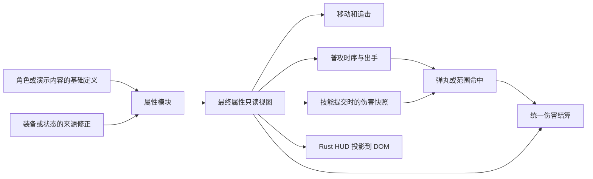

# 基础属性系统设计提案

本文已由用户于 2026-11-07 批准，首轮和追加实现均已完成并提交，任务已归档。
需求与验收以 [prd.md](prd.md) 为准；原始源码依据见 [research/current-system.md](research/current-system.md)。
实际验证结果记录于 [validation.md](validation.md)。

## 1. 架构目标

属性、伤害和攻击时序各有唯一实现，调用方只提交定义/修正并读取结果。
保留单 crate、Bevy ECS、60 Hz 固定步及 `client → simulation` 依赖方向。
使用现有命令、动作和效果执行流程，不另建一套战斗世界。



图中装备、状态和角色是未来调用方，本期实现属性接口及现有内容接入。

## 2. 模块接口与状态所有权

| 模块 | 本期职责 | 不承担的职责 |
|---|---|---|
| 新增 `simulation/attributes.rs` | 基础/最终属性类型、来源修正、校验、原子重算、修正队列消费 | 装备格、状态持续时间、角色选择 |
| 新增 `simulation/damage.rs` | 伤害类型、加成表达、提交快照、抗性公式 | 弹丸碰撞、生命写入、被动事件分发 |
| `simulation/model.rs` | 单位静态定义、受保护的运行态、指令与结果事件 | 属性计算公式 |
| `simulation/actions.rs` | 施法提交、普攻提交、时序快照和效果生成 | 抗性计算、角色/装备专属分支 |
| `simulation/orders.rs` | 用最终射程追击和开始攻击 | 临时修改攻击力/移速 |
| `simulation/movement.rs` | 用最终移速走路，独立处理既有冲刺 | 推导装备加成 |
| `simulation/combat.rs` | 命中收集、统一扣血、死亡、重生，调用伤害计算 | 在多个命中分支复制公式 |
| `client/content.rs` | 示例单位基础定义、技能加成配置 | 维护第二份实时属性 |
| `client/ui.rs`、`web/hud.js` | 只读投影、格式化、布局 | 推算最终属性和伤害 |

`mod.rs` 只导出构造、输入和只读观察所需的类型；计算和缓存实现保持私有。
不引入每项属性一个插件、通用表达式脚本、动态 trait 注册或额外调度框架。

### 2.1 定义与运行态

建议使用以下形状，具体命名在实施时保持一致即可：

- `BaseAttributes`：内容定义的七项基础值。
- `EffectiveAttributes`：模拟维护的七项最终值，只允许通过只读接口观察。
- `UnitStats`：保留为 `UnitSpec.stats` 的构造定义，组合 `base_attributes`、既有生命/法力/回复、
  碰撞半径和 `attack_windup_fraction`。生命/法力上限与碰撞半径本期仍为静态参数。
- `AttributeState`：模拟内部持有按来源排序的修正集合和最终值缓存；基础值来自单位定义，
  不保存第二份可独立修改的基础值。
- `Unit::definition()` 返回静态定义，`Unit::attributes()` 返回最终属性。
  迁移掉含义模糊的 `Unit::stats()` 运行时读取，避免移动/攻击误读基础值。

`Unit` 仍是既有实体上的权威单位状态，不要求客户端装配新的 ECS 组件。
属性缓存只有属性模块可更新；构造和死亡清理通过模块函数完成。
基础值本期出生后不变，未来角色成长需要新增明确的基础值更新接口。

### 2.2 七项属性和单位

| 字段建议 | 中文 | 基础值约束 | 最终值约束 | 现有示例默认 |
|---|---|---|---|---|
| `attack_damage` | 攻击力 | 有限且 ≥ 0 | ≥ 0 | 40 |
| `ability_power` | 法术强度 | 有限且 ≥ 0 | ≥ 0 | 0 |
| `armor` | 护甲 | 有限，可为负 | 可为负 | 0 |
| `magic_resistance` | 魔抗 | 有限，可为负 | 可为负 | 0 |
| `move_speed` | 移动速度 | 有限且 ≥ 0 | ≥ 0，世界单位/秒 | 5.5 |
| `attack_range` | 攻击距离 | 有限且 ≥ 0 | ≥ 0，世界单位 | 5.5 |
| `attack_speed` | 攻击速度 | 有限且 ≥ 0 | 0 或可调度的正值，次/秒 | 1.25 |

攻速定义为最终攻击频率，不再同时维护可独立配置的 `attack_period`。
默认前摇比例为 `0.22 / 0.8 = 0.275`，而非另存一份绝对前摇时间。
基础/修正/派生结果均拒绝 NaN 和 Infinity；派生时检查数值范围和 tick 表达能力。

## 3. 来源修正与原子更新

### 3.1 来源标识

- 使用类型化 `ModifierSourceId`，由模拟的 `AttributeChanges` 资源分配，当前 World 内不复用。
- 同一单位、同一来源对应一组修正，可一次影响多项属性；使用有序映射按来源稳定聚合。
- 未来每个装备实例、增益实例持有自己的来源 ID；同种装备的两个实例不能共用一个来源。
- 不用字符串描述属性或来源，也不把装备 ID、角色 ID 写入属性算法。

### 3.2 本期支持的运算

每项修正具有 `flat` 和 `additive_percent`，百分比用小数表示，20% 写为 0.2。

```text
flat_sum = 所有来源固定值之和
percent_sum = 所有来源加算百分比之和
candidate = (base + flat_sum) * max(0, 1 + percent_sum)
```

- 攻击力、法强、移速和攻击距离最终截断到 `[0, f32::MAX]`。
- 护甲和魔抗保留负值并限制在有限的 f32 范围；本期百分比是对合计值乘算，
  不等价于未来的护甲削减或穿透。
- 攻速为 0 时禁止开始普攻。正值限制在可表达的时序范围：
  `MIN_ATTACK_SPEED = TICK_RATE / u32::MAX`，
  `MAX_ATTACK_SPEED = TICK_RATE / 2`。60 Hz 时上限为 30 次/秒。
  下限仅防止整数计时溢出，不另设常规玩法的攻速平衡上限。
- 用 f64 中间值聚合，再按上述范围饱和转换。输入必须有限，若中间结果意外非有限则拒绝更新。
  饱和规则保证移除来源和死亡清理不会因为剩余加成过大、或正攻速过小而失败。
- 未被修改的属性使用对应零修正；不提供本期没有需求的覆盖值、乘法修正层或优先级系统。

例：攻击力基础 40，A 固定 +10、B +20%、C +30%，结果为 `(40 + 10) * 1.5 = 75`。
移除 B 后结果为 65；将 A 替换成固定 +20 后结果为 78。
每次从基础值与现存来源重算，不对最终值做加减还原。

### 3.3 写入接口

`AttributeChanges` 是模拟规则输入队列，与玩家 `CommandQueue` 分开：

1. `allocate_source` 分配来源 ID；来源句柄分配本身不改变单位属性。
2. `upsert(unit, source, modifier)` 入队新增/替换请求。
3. `remove(unit, source)` 入队移除请求；单位存在但该来源不存在时成功且无副作用。
4. 固定步按 FIFO 消费，对目标、来源和全部数值校验，计算候选结果。
5. 候选完整合法后一次替换来源集合与最终缓存；失败发布类型化拒绝结果，旧状态保持不变。

这是供装备/状态等规则调用的接口，不增加玩家修改属性指令或浏览器调试后门。
同一步内不同请求顺序明确；每条请求分别原子生效，不把整帧当成一个必须全成功的事务。
无实际值变化时不写缓存，避免无意义的 Bevy 变更标记。

### 3.4 生命周期

每个来源声明移除策略：

- `Explicit`：持久修正，直到明确移除；未来装备可以采用此策略。
- `OnDeath`：单位死亡时移除；未来临时状态可以采用此策略。

死亡结算时清理 `OnDeath` 并重算，保留 `Explicit`；重生不重新叠加已有修正。
死亡单位允许更新持久来源；对死亡单位添加临时来源拒绝，避免复活后带入死亡期间的临时增益。
实体移除时其集合随实体销毁；队列中的失效目标按无效单位拒绝。
本期不加入修正计时器、叠层规则、驱散或免疫；后续状态模块在到期时移除自己的来源。

## 4. 统一伤害模型

### 4.1 三个阶段

| 阶段 | 数据 | 规则 |
|---|---|---|
| 定义 | `DamageSpec` | 类型、基础伤害、攻击力系数、法强系数；注册时校验 |
| 提交 | `DamageSnapshot` | 读取来源最终攻击力/法强，计算并保存原始伤害、来源和类型 |
| 命中结算 | 类型化 `DamageRequest` | 读取目标当时最终抗性，调用唯一公式，实际扣血并发事件 |

```text
raw = max(0, base_damage + ad_ratio * attack_damage + ap_ratio * ability_power)
```

数值和系数必须有限且非负；若组合结果不可表示，技能提交拒绝且不扣费、不进冷却。
`DamageOrigin` 区分 `BasicAttack` 与 `Ability(AbilityId)`，只携带事实，不执行被动逻辑。
`PendingDamage` 从裸三元组改为类型化请求，避免未来装备被动丢失伤害来源语义。

### 4.2 抗性公式

物理伤害使用护甲，魔法伤害使用魔抗；真实伤害跳过抗性。

```text
resistance >= 0: multiplier = 100 / (100 + resistance)
resistance <  0: multiplier = 2 - 100 / (100 - resistance)
mitigated_damage = raw * multiplier
health_loss = min(current_health, mitigated_damage)
```

100 抗性减半；0 抗性不改变伤害；-50 抗性使伤害变为约 1.333 倍。
使用浮点生命值，模拟不提前四舍五入。0 伤害不发布有效受伤事件，也不触发死亡。
`SimulationEvent::Damaged.amount` 继续表示实际生命损失，补充伤害类型/来源信息；
不要把原始伤害误当成实际损失，过量伤害不能导致负生命。

### 4.3 快照与死亡

- 普攻伤害在出手成功时快照；技能在现有提交点快照。
- 弹丸和延迟范围保存快照；引导在技能提交时保存快照，每个脉冲复用该快照。
- 来源之后属性变化、死亡或实体移除，不改变已提交效果的数值。
- 目标抗性在各次命中时读取，引导后续脉冲可以受到目标抗性变化影响。
- 不在命中时通过来源实体重新计算伤害，避免来源消失导致效果丢失。
- 来源队伍等命中筛选信息继续随效果保存；不改变现有友军过滤和碰撞规则。

### 4.4 演示内容迁移

普攻使用物理伤害、攻击力系数 1。现有 Q/W/R 使用魔法伤害：

| 技能 | 基础伤害 | 建议法强系数 | 说明 |
|---|---|---|---|
| Q 奥术飞矢 | 75 | 0.6 | 单次命中 |
| W 震荡领域 | 120 | 0.8 | 每个命中的目标 |
| R 共鸣 | 35 | 0.2 | 每个脉冲 |
| E 流风步 | 无 | 无 | 保留位移效果 |

这组系数用于展示配置能力，不是最终平衡结论。默认法强/抗性为 0，既有基础扣血量保留。
单独用自定义单位的无窗口场景证明非零法强和抗性生效，不为演示加成引入新 UI。
暂不拆分完整的“目标选择/投射方式/任意效果组合”体系，该改造归下一期技能任务。

## 5. 移动、距离与攻速

### 5.1 移动和攻击距离

- 普通移动每 tick 预算为最终移速乘 `TICK_SECONDS`；移速 0 保留路径和意图但不位移。
- 已有冲刺使用技能配置的独立速度；减移速不隐式改变冲刺速度。
- 获取范围、追击停止、出手复核、客户端普攻范围圈统一读取最终攻击距离。
- 延续既有距离语义：攻击距离是双方碰撞边缘之间的距离，中心距离阈值加双方半径。
- HUD 显示配置的边缘距离；技能射程保持既有独立规则，不随普攻射程增加。
- 攻击距离 0 代表接触攻击，不代表禁止攻击。

### 5.2 普攻时序

在新普攻开始时，读取一次最终攻速并派生整数 tick 时序：

```text
period_ticks = clamp(ceil(TICK_RATE / attack_speed), 2, u32::MAX)
windup_ticks = clamp(ceil(period_ticks * attack_windup_fraction), 1, period_ticks - 1)
remaining_interval_ticks = period_ticks - windup_ticks
```

- `attack_windup_fraction` 为有限的 `[0, 1]` 定义值，执行时保证上述至少一 tick 的两个阶段。
- `AttackWindup` 保存本次前摇与剩余间隔快照；前摇结束时仍按原规则检查目标与射程。
- 出手成功后提交该次剩余间隔；失败/取消前摇不提交新普攻冷却。
- 出手前已有的动作取消规则保留；出手后的间隔不被移动、停止、换目标或重复指令重置。
- 攻速变化不缩短或重启当前前摇/已提交间隔，只影响下一次新攻击；攻速 0 不开始新普攻。
- 伤害数值仍在出手时读取最终攻击力，故“时序快照”和“伤害快照”是不同时间点。
- 先按属性模块限制正攻速，再以 f64 推导并饱和转换为 u32 tick，不能因舍入越界或变为零周期。

实施检查发现 f32 `TICK_SECONDS` 会将技术最大攻速的两 tick 周期舍入为略大于 2，进而错误向上取整为 3。
因此直接使用 f64 `TICK_RATE` 推导上下限和周期，保留原规则的数学含义，并用最大攻速出手序列回归。

固定步造成的频率量化误差不超过一个 tick 的周期向上取整；HUD 显示最终攻速目标值，
提示单位为次/秒。默认 1.25 次/秒对应 48 tick，前摇比例迁移会使旧浮点计时的部分边界差一 tick，
这是统一时序后的明确变化，测试应断言规范时间点而非放宽到任意等待。

## 6. 固定步顺序和一致性

建议在现有固定步链中只增加一个阶段：

1. 推进 tick。
2. 处理重生。
3. FIFO 消费属性修正请求，校验并立即重算最终缓存。
4. 消费玩家指令。
5. 推进冷却和动作，提交普攻/技能。
6. 解析持续指令、追击和开始新攻击。
7. 移动、弹丸、范围命中。
8. 统一伤害与死亡结算；死亡时同步清理临时属性来源。

因此 tick 开始前入队的属性变化对该 tick 的玩家校验、伤害提交和移动都可见。
任何未来在第 3 步之后入队的修正默认下一 tick 生效；需要命中内即时效果时，
由后续效果系统定义统一阶段，不允许装备代码偷偷跳过属性所有权直接写缓存。
暂停冻结整条链，队列留存，恢复后按顺序消费一次。

## 7. HUD 数据与布局

### 7.1 数据约定

在 `UnitView` 增加 `attributes`，包含七个明确 snake_case 字段和原始数值。
玩家属性由 `player_id` 对应单位读取，后续切角色无需把 HUD 写死到旅者定义。
Rust 返回最终值；JavaScript 只做显示格式化，不执行百分比、抗性或攻速推导。
保持原 80 ms 完整快照节流与独立的逐帧血条坐标通道。

显示建议：攻击力/法强/护甲/魔抗最多一位小数，移速/距离/攻速最多两位，去除无意义尾零；
保留负抗性符号，极小非零值不格式化成误导性的 0。无玩家数据时显示 `—`。

### 7.2 布局建议

```text
底部角色卡片
┌──────────────────┬──────┬──────────────┬───────────────────┐
│ 攻击力    法强    │      │ 角色名称/动作 │                   │
│ 护甲      魔抗    │ 头像 │ 生命条        │ Q   W   E   R     │
│ 移速      攻击距离 │      │ 法力条        │                   │
│ 攻速（次/秒）     │      │              │                   │
└──────────────────┴──────┴──────────────┴───────────────────┘
```

属性区在卡片内最左侧，带完整中文标签，可用现有 SVG 风格做小图标辅助，不用纯图标代替名称。
整区继承 `data-ui`，增加 `#hero-stats`、`[data-stat]` 稳定选择器。
1280×800 保持横向；800×600 通过紧凑两列属性、收窄信息区和必要的卡片增高避免覆盖技能。
较窄宽度可重排卡片行列，属性保留在左侧区域，不以隐藏属性换取布局通过。
小地图和镜头提示同步检查，避免新增宽度产生重叠。

本期不做原生端新交互面板；已有 native 文本 HUD 可投影同样七项值，用于一致性检查。

## 8. 与下一阶段的衔接

| 后续任务 | 复用本期能力 | 后续才新增的机制 |
|---|---|---|
| 技能/状态效果 | 类型化伤害、最终属性、带来源的负移速修正 | 目标与投射解耦、效果组合、中断权限、状态计时/叠层/驱散 |
| 角色与技能装配 | 角色提供基础属性与技能 ID 列表 | 角色定义/选择，实例装配及随机分配规则 |
| 六格装备 | 每实例来源修正、伤害事实、既有技能提交过程 | 槽位、装备定义/实例、被动触发与防递归、主动装备施法入口 |

装备主动技能后续复用施法生命周期，但本期不把装备硬塞进 Q/W/E/R 的四槽数组。
技能可以被多个角色装配，属性和伤害代码不依赖角色 ID。

## 9. 迁移、风险与回退

- 当前没有存档或网络协议迁移需求。Rust 构造接口可以在同一改动中升级，必须同步所有内容和测试。
- 先把静态定义与最终属性读取分开，再加入可变来源；中间版本仍需能构建和通过原行为测试。
- 伤害类型与快照要一次贯穿定义、弹丸、范围、引导、待结算请求和事件，不能留下裸数值旁路。
- 范围圈位于 `src/client/scene.rs`，容易遗漏；静态碰撞半径/生命上限读取不能误换成七项属性。
- 重点风险：默认时序一 tick 迁移、负抗性、属性缓存滞后、重复来源残留、来源死亡后的快照、HUD 小窗口拥挤。
- 回退按 [implement.md](implement.md) 中的阶段提交回退；不清空工作区，不重置用户服务，不修改备份分支。
- 首期不额外引入依赖。公式、数值上限和生命周期必须在落地后同步到 `docs/architecture.md` 与 Trellis 规范。


## 10. 已授权追加修订：普攻后摇

为普攻增加 `UnitAction::AttackBackswing { remaining, duration }`，两个字段均为整数 tick。
出手成功后以本次时序快照的剩余间隔初始化；独立的攻击间隔时钟保留在 UnitState。
后摇可被显式移动/停止/换目标/施法取消，间隔不受影响；相同目标的重复攻击保持当前动作。
后摇自然推进与间隔同步，不给连续攻击额外增加 tick。技能 Recovery 保持独立。
客户端读取该动作显示后摇，可通过模型子层的简单收招姿态表现，不能改变模拟位置或用动画决定攻击命中。

HUD 仅缩减属性区和改展示标签/顺序，不改 Rust JSON 字段名与七项规则。
