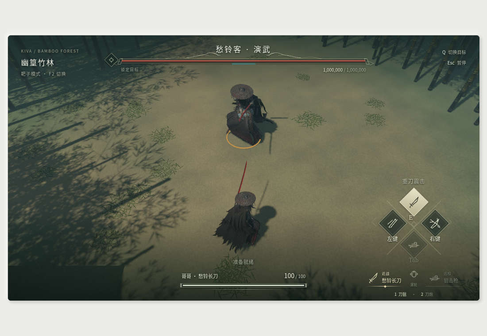
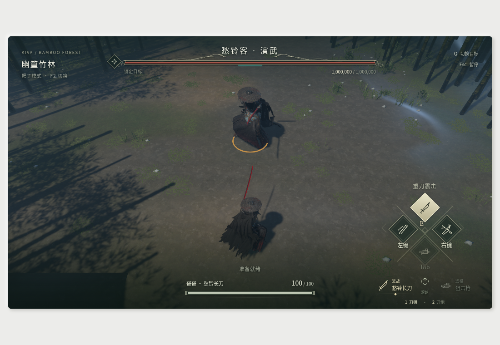

# 竹林参考画面的材质与光照改进

用户给出的原作画面用于色彩、地表、植被层次和湿润反射的参考。本轮承接已交付的愁铃客角色/动作/Boss，继续不创建Trellis任务，游戏目录只读；不把主题重建称为完整原关卡恢复。

## 行为差距与所有权

当前地面只有顶点颜色和程序噪声，自写shader又把粗糙度覆盖为0.83–0.96，导致缺少材质细节与干湿区别；林缘缺少草丛和碎物层次，简化环境光也没有参考图的冷暖纵深。目标是在既有俯视镜头下使泥土、湿地、落叶、竹皮和林缘植被能被清晰区分，湿面有实际场景反射，远景保留冷色雾与层次。

变化位于client表现层：原地形/竹干/岩石继续直接消费Level同源几何，不能另造碰撞面，不能反写Body。普通相机FOV/高度/构图、角色/动作和模拟规则保持既有契约。

## 实施范围

- `assets/choulingke/environment/`及离线导入工具：从已恢复Repository条目中定向定位地表/草丛原纹理，保留GUID、物理VFS、包偏移、SHA、通道角色及适配说明；不把未经验证的打包图猜成ORM。
- `src/client/forest_material.rs`、`assets/shaders/forest.wesl`：接入真实地表base/normal，材质驱动粗糙度，按空间mask区分干土/湿土/积水；保留标准PBR的光照与非金属反射，不能靠把泥土设成金属冒充水。
- 新的`src/client/rendering.rs`（如必要）及`client/mod.rs`最小注册：使用已安装Bevy 0.20.1的实际接口接反射/接触阴影和相机色调设置；SSR需要deferred与prepass时，同步验证原蒙皮、ExtendedMaterial与近叶退隐所有相关pass。不得只贴设置组件而不验证实际画面。
- `src/client/environment.rs`及必要的局部子模块：原始地表纹理UV/切线、共享材质装配、林缘成簇草与落叶碎物，冷暖光/环境反射/距离雾。装饰不新增碎小碰撞、不侵占战斗出生净空；材质/网格共享，风动随SimulationActive暂停。
- 文档/TODO/实际规范与截图：按实际达成程度记录，视觉验收以同机位前后对照为准。

当前已有近相机枝叶退隐仅改主片元。若引入DepthPrepass/DeferredPrepass，必须同步相同的相机可见片元裁切，避免隐藏枝叶提前写深度。反射具体技术以WebGPU真实可用为准；不采用镜像角色网格或伪造第二套模拟来制造倒影。

本轮不涉及更换玩法镜头、修改攻击AI/动作/武器数值、原BGM解码或原地图完整实例恢复。若需要抽出环境局部模块，只移动表现职责，用同源几何/暂停/资源复用回归证明没有改变模拟行为。

## 验收

先保留同一静止机位/朝向的旧图；新图必须可见地表纹理、局部干湿差异及反射、连续林缘植被与冷色远景，同时角色轮廓可读。另验证移动、卸势/跳跃、近叶遮挡、暂停和模式切换，捕获实际WebGPU shader日志，不以编译通过等同画面达标。

运行相关材质/几何/渲染回归、`make check`、WASM Clippy、临时目录Trunk构建；核对Cargo.lock和资源来源清单。用户的常驻开发服务由用户控制，测试只用可回收的HTTP fixture/浏览器实例。新增代码完成后再按本轮授权边界处理提交推送。

## 本轮落地与验证（2026-11-10）

已实现14张可溯源原贴图，其中新增8张土壤/草苔/两类草叶；离线工具验证GUID与原始SHA再导入，保留未知打包通道。地表增加真实主色/法线、线性颜色与单位法线mip及分层干湿mask，消除原shader无条件覆盖粗糙度的问题。积水保持metallic=0、roughness=.14；湿土roughness=.56，阻止高频泥土normal参与随机SSR后出现的白色闪点。

环境现为20个聚合网格/7个共享材质，12组风动装饰。最初大椭圆净空把镜头内草丛全部排除，实测后改为出生/目标净空与4m战斗通道，并用实际camera::setup投影回归检查两侧草丛可见。细草按不规则斑块散布，阔叶草降低高度和比例；源gancao atlas裁出五组叶片并染绿属于Kiva适配。主方向光/冷色填光/半球环境光与雾已调整。

相机安装真实deferred、DepthPrepass、SSR、HDR/FXAA；近叶片主片元与深度prepass使用共享裁切函数。现有透光材质的Auto本就采用Forward，未把它误记为本轮修复。没有改变相机姿态/FOV、角色骨架或模拟/碰撞权威。

同一1100×760浏览器窗口、同一初始机位/朝向的实际WebGPU对照（非性能基准）：

| 修改前 | 修改后 |
|---|---|
|  |  |

实际GPU验证记录位于项目外研究目录 `/home/asuka/kiva-asset-research/choulingke/`：

- `browser-reference-final.json`：静止材质/闪避两状态、暂停，JS/WebGPU错误为空；截图为真实Bevy画布。
- `browser-reference-audit.json`：记录到7次ssr及相应deferred/prepass pass、两个SSR pipeline，证明实际执行。
- `browser-reference-gbuffer.json`：实际RGBA32Uint GBuffer读回，靶前积水多点粗糙度为36/255（.141176），法线朝上；不是仅添加配置组件。SSR命中遮挡并未单独量化。
- `render-reference-check.log`：`make check`通过（188 Rust库测试、9物理集成、49 Node测试）；WASM Clippy和临时目录Trunk构建通过。Cargo.lock无变化。

原图是低位第三人称，本项目既有机位较高，地面投影与非金属水面Fresnel不同，黑衣倒影偏弱；此轮是材质/植被层次改进，不宣称同构图或完整原作渲染器恢复。SSR仅覆盖屏幕内深度与已完成deferred颜色，前向植被/皮肤、屏幕外物体存在反射限制。移动/卸势/跳跃与模式切换沿用已有回归，本轮浏览器专项覆盖静止、闪避和暂停；没有把未重新手验的动作记成新增浏览器证据。

按用户最新授权提交并推送本轮画面，再继续处理原版audio/BGM；音频未因本轮画面完成而勾选。
