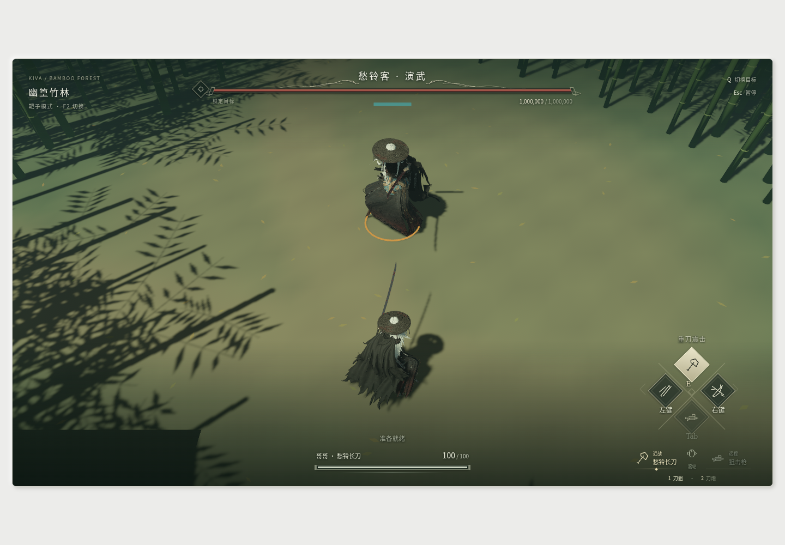

# 愁铃客与竹林镇守改造

> 本文记录首次实现与当时验收；本轮原骨架/原动作、材质和单Boss变化见[后续方案](choulingke-source-behavior-and-rendering.md)。历史测试计数和未恢复状态不代表当前版本。

## 目标与边界

落实 `docs/TODO.md` 的“解析燕云十六声之后需要做的事”：愁铃客角色与合适的近战武器、竹林场景、大号愁铃客靶子、右键卸势、对应声音。

角色提取已确认 `C3/Boss/ylk` 的 14 个部件及四级细节。使用完整目录、文件名、GUID、资源包索引和解码结果共同核对归属；相邻的 `yqzj/hengdao` 资源已经排除。原始文件、绑定矩阵、材质参数及来源记录保留在项目外的研究目录，运行时只读取经过转换并随项目打包的资源，不读取游戏安装目录或联网下载。

这次改造的代码边界：

- `simulation/` 负责卸势窗口、冷却、正面判定及受击结果；沿用固定步、暂停、动作权限和反馈历史。
- `gameplay/` 负责竹林地形、出生点、竹子碰撞与敌人装配。仍由一份关卡数据生成碰撞和显示，不在客户端另造运动规则。
- `client/` 负责蒙皮角色显示、既有动作的适配、武器外观、竹叶/雾/灯光、声音及 HUD。角色显示根只读取物理快照。
- 输入桥和浏览器音频桥继续各自拥有设备与平台生命周期；短按卸势作为锁存动作，不依赖某帧碰巧读到右键按住。

不改变现有两套联动的伤害权威、固定步调度及视角输入约定；不把刀鞘误当第二种近战兵器。当前未发现合适的远程资源，狙击与火炮继续使用现有外观。

## 资源与角色方案

1. 离线导出并校验模型、UV、蒙皮权重、骨骼名字和逆绑定矩阵；按真实材质槽读取 `tBaseMap`、`tNormalMap` 等绑定，保留暂不能移植的原作着色器参数。
2. 随包角色资产与动作资产分开。原作未恢复的父子骨骼层级不能伪称已经恢复；以已知绑定姿态、明确的骨骼映射和现有 `RigPose` 驱动表现，并验证静止、移动、跳跃、蹲伏、普攻、联动及暂停。
3. 玩家与敌人复用角色网格、贴图和材质缓存。大号靶子的显示比例与物理尺寸由装配配置表达，生命、攻击和复活仍归模拟所有。
4. 两套近战优先复用已确认的长刀外观；刀鞘和腰侧短刀作为角色配件。武器继续跟随右手，远程枪口和射击特效继续读取实际武器姿态。

## 竹林方案

以“大雾幽篁”的竹海、林间空地和低饱和青绿色氛围为视觉目标，使用确定性关卡布置、连续地形、林间通路和密集外围竹林，保留练习联动所需的出生净空和战斗空地。竹干的阻挡与渲染使用同源位置；叶片、落叶和薄雾仅作表现。

原作完整地图的实例布置尚未从 HD/v2 配置库恢复，因此不得把重新布置的竹林宣称为原版地图的一比一导出；实现和验收记录明确区分原始角色资产与竹林场景重建。

## 卸势方案

右键按下提交一次卸势请求；持续按住不循环卸势。默认有效窗口 0.25 秒、起手冷却 0.65 秒；仅地面、存活且可行动时接受。有效窗口内正面近战受击免除本次伤害，并让攻击者进入恢复，产生一次明确的卸势反馈；侧后方、窗口外和非法动作中按键不能获得旧格挡的持续减伤。所有计时随暂停和命中停顿冻结，死亡/复活清理请求。

通过真实固定步验证短按锁存、时间边界、朝向、重复按键、连续受击、非法状态和暂停；视觉与音频只消费最终结算事件。

## 声音方案

优先从原始音频资源及其元数据核对目标声音，记录来源和转换过程。背景音乐循环与攻击、命中、卸势等短音效分离；仅在可信进入操作后解锁 Web Audio，暂停与恢复不叠加循环，反馈按序号消费，并限制短音效并发。若原作 BGM 尚不能可靠定位，必须在完成记录中明确标注，不能将任意曲目冒充该镇守 BGM。

## 实施与验收

1. 完成资源、蒙皮与材质转换，保留可复现工具和来源清单。
2. 并行实现模拟层卸势与玩法层竹林，随后接入客户端角色、武器、输入、HUD 和音频。
3. 更新架构与实际规范，只记录已经实现的契约；保留用户对 TODO 的原始编辑，逐项依据验证结果勾选。
4. 执行 `make check`、WASM Clippy 和临时目录 Trunk 构建。另以可回收的测试方式验证资源加载和实际画面，不启动或关闭用户的常驻开发服务。
5. 最终记录实际资源、操作、测试结果及剩余限制；不自动提交或推送。

## 实现结果与验收记录（2026-11-10）

已实现角色蒙皮/专属长刀、竹林主题重建、1.45倍被动愁铃客靶子和右键卸势。两套近战共用长刀外观、分别保留震击/旋斩机制，远程保持原有枪炮。角色缓存32张缩放纹理、原始UV/权重/绑定矩阵，标准身高1.73m；具体转换和近似见[角色说明](../../assets/choulingke/README.md)。原始父子层级和次级物理没有恢复，动作来自已有CC0资源适配。

卸势0.25s/冷却0.65s，成功后攻击者恢复0.45s；狙击和旋转中按右键丢弃请求，不取消联动、不耗冷却。靶子的物理尺寸、蹲起净空、传送、复活、血条和胸口瞄准点均统一读取Body尺寸；脚底仍用于范围判定。目标初始朝向出生点，便于观察面具和武器。

声音桥已接实际挥刀/受击/卸势与射击反馈，修复火炮Shot+Cannon重复枪声；当前三种短音效是Kiva自制程序音效，枪声沿用原合成器。**原作镇守BGM未完成**，`music.json.file=null`，不把未识别文件当原曲使用。音乐缓存/循环/暂停恢复接口和测试已准备，来源调查见[音频状态](../../assets/audio/README.md)。这也是TODO最后一项未勾选的原因。

实际浏览器已显示玩家、放大靶子、长刀、纹理、竹林和目标血条；已观察实际AudioContext成功解码3个随包短音效并播放射击/受击。截图使用临时Chromium实例，通过用户已有Trunk服务读取页面；没有启动或关闭用户开发服务。软件WebGPU最初丢失设备，改用WSLg有界面Chromium与Vulkan/SwiftShader测试参数后呈现正常；不将软件渲染帧率当作Windows实机性能结论。自动测试截图固定输入yaw以排除指针捕获重定位对构图的干扰。

代码分层保持client→gameplay→simulation。已补真实固定步回归和浏览器生命周期回归，最终检查：`make check`通过（158个库测试、9个地形集成测试、49个Node桥接测试、原生Clippy/格式/WASM编译）；额外WASM Clippy通过。临时目录Trunk构建成功，已核对3个Ogg和music.json确实复制进产物，Cargo.lock哈希未改变。构建日志保存在项目外研究目录 `kiva-check.log` / `kiva-wasm-clippy.log` / `kiva-trunk-build.log`。
