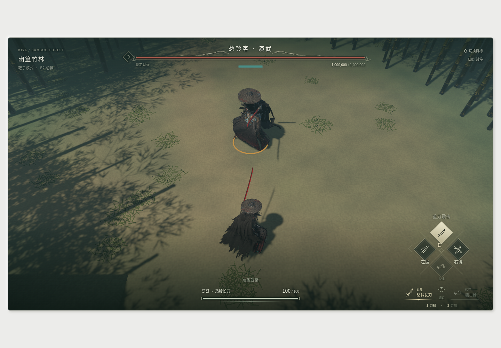
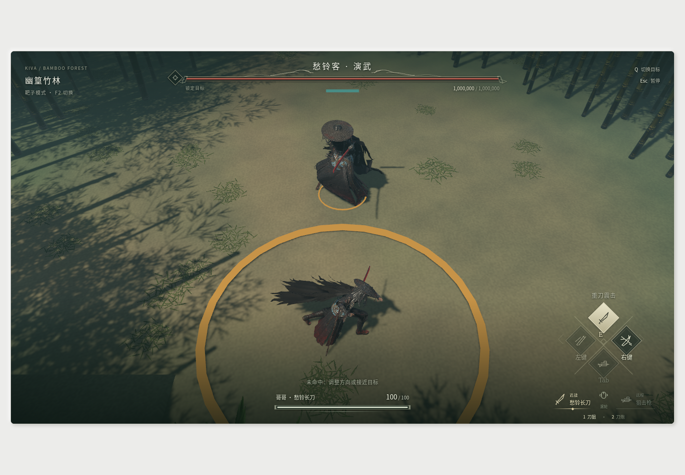
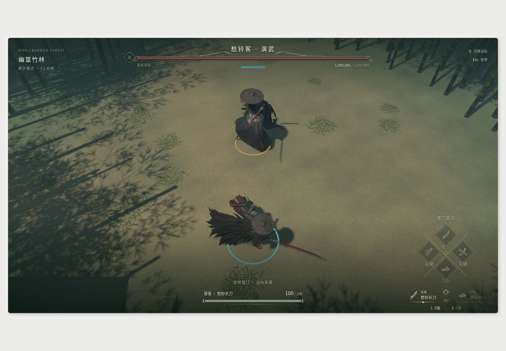
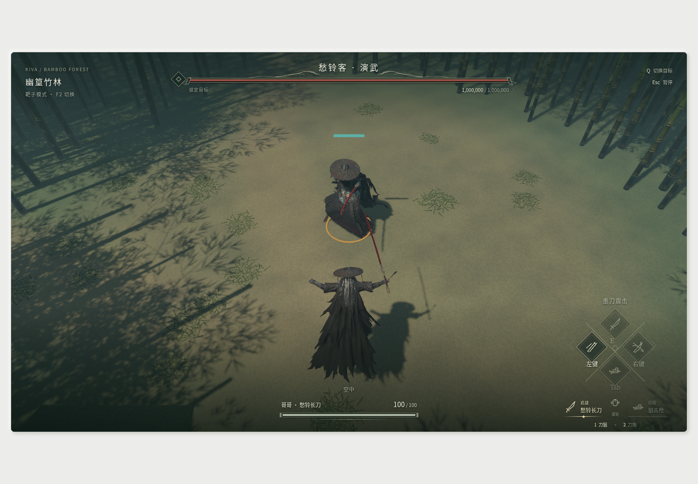
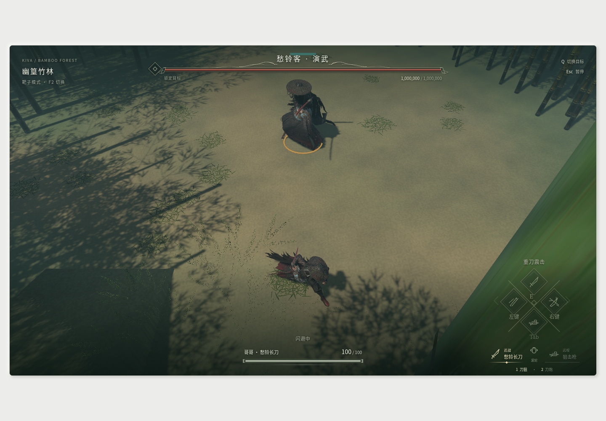
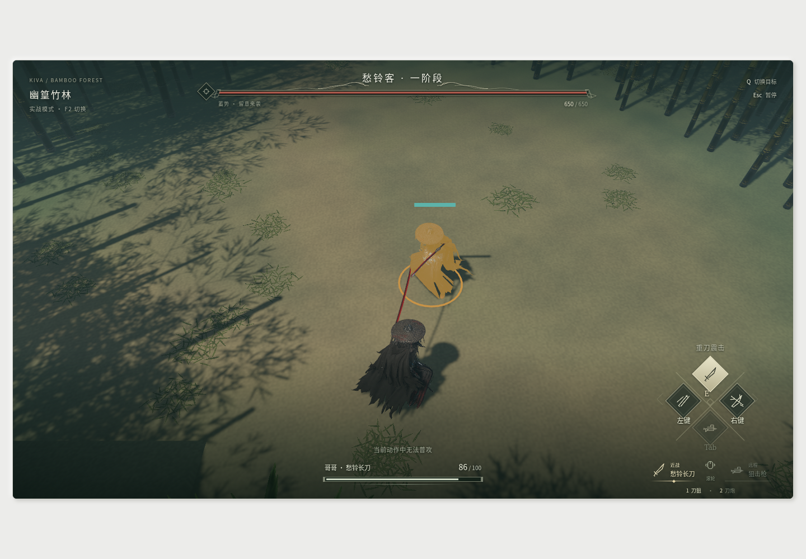

# 愁铃客原动作、材质与单Boss对战

本轮承接 `docs/TODO.md` 的“后续增加需求”，继续不创建 Trellis 任务，保持游戏目录只读。原有角色、竹林、卸势和武器联动作为基线；资源来源必须可验证，原作恢复结果与Kiva适配参数分开记录。

## 原作动作

从真实graph的AnimFile引用定位 `Char/c_77_boss_yulingke/yulingke.skeleton`。该资源已完整解析，有129项动画注册、原始路径/时长/根运动/Cue，以及986节点的真实骨架树；身体Skin调色板名称全部与主树对上，绑定矩阵数值交叉验证通过。部件subskel包含软骨链/碰撞配置，不能拿它冒充人体主骨架。

已严格解码120个本地原文件至CHANNEL_DATA完整边界，导入30个愁铃客具名动作；另从父common注册中恢复具名共用卸势、跳跃三阶段和闪避，共35个随包clip。原毫秒稀疏键保留，没有用静态绑定姿态冒充动作。90个含共享骨名引用的文件未猜绑定，9个注册路径未定位。移动/待机、蹲滑、枪姿和部分特殊动作仍CC0回退。物理根位移、跳高和伤害仍由模拟决定，动作只驱动显示骨骼。原作Cue的声音可用于恢复原SFX，但不能借动画回调结算伤害。

## 材质与环境

之前已使用StandardMaterial PBR。视觉简化的原因是仅保留base/normal、统一粗糙度和程序化地表/叶片，尚缺原材质的混合贴图及专用响应。

本轮从本机LocalShaders缓存解压DXBC/DXIL，以微软dxc反汇编校验纹理通道和常量。已核实的shader家族使用原mix转换成标准金属度/粗糙度/AO；未核实的细节不猜作已经恢复。继续保留GPU蒙皮、标准深度/阴影通路，按头发、布料、面具和刀刃配置有依据的材质差异。原HLSL正文和完整原BRDF/SSS/细节阵列特效不宣称已移植。

竹林使用自写ExtendedMaterial/WESL补充地表土/苔纹理、竹干和岩面细节；优先提取真实竹叶/竹皮贴图。装饰叶片风动不移动碰撞竹干，暂停冻结表现时钟。光照补充半球环境和冷色填光，降低硬阴影反差，并在实际浏览器对照截图验收。

## 原AI与Kiva适配

保留已恢复的原始LUAL、函数块、重组字节码、反编译节点和来源哈希，不执行原游戏脚本。P1/P2主树、Action及ComboCondition的数据节点与父子关系已可验证；优化指令的反编译缺口须明确，不以“能通过语法检查”代替语义正确。

实战改成单一愁铃客Boss。决策池、权重、行动槽和可确认的action_flow_time规则取自原树。Boss组件在simulation拥有阶段、当前招式、冷却、预警/出招/恢复、无敌和被卸势状态；gameplay仅装配；client只读快照选择原动作、材质和反馈。旧普通Enemy主动AI/复活不得与Boss并行控制同一实体。

原技能槽到实际技能/动作及关键帧的完整配置仍需恢复。未知命中体积、伤害和阶段切换不能冒称原值，应集中列为Kiva适配。采用两条生命阶段时明确属于Kiva适配，不能把原树65/75/30条件草率当作阶段阈值。运动继续由Avian求解，固定步、暂停/HitStop、卸势、死亡/复活和模式切换都必须有回归。

## 验收

原始资源调查保存在 `/home/asuka/kiva-asset-research/choulingke/`；随包只放必要转换数据与精简来源记录。完成后更新实际架构规范和TODO，运行完整 `make check`、WASM Clippy、临时产物构建，并检查真实WebGPU画面、角色动作、单Boss战斗和声音生命周期。未恢复的原作部分保留明确状态，不用猜测资源填补完成标记。

## 已落地结果与边界

- `source_animation`独立解码986节点/35clip的KIVASR01，RigPose复用原状态优先级与时钟；avatar逐骨名驱动原调色板，原手腕rest增量校正握柄。原长刀skill片段、共用卸势、三段跳跃和闪避均已接入；共同动作保留愁铃客骨长，裁剪/时长写入manifest。Boss被卸势时直接读取Deflected中断旧挥刀，不依赖向Boss伪造Hit事件。
- 角色V2含49张图片：原base/normal和17张验证后转换的线性ORM；原竹叶/竹皮/落叶六图随包，11环境网格/5共享扩展材质，标准PBR/阴影与同源碰撞保留。真实WebGPU发现未经验证的GGX各向异性令哑光披风爆出银白高光，仅关闭该项即恢复；另按源超界UV启用Repeat。
- 实战单Boss使用原P1/P2距离池、权重、57个行动槽与冷却；五棵原树静态恢复955函数/808节点。650×2生命、命中体积和14/18伤害等是Kiva适配。完整连招取消、原阶段触发、buff/抓取/索魂和原slot→clip/命中帧未恢复，TODO完整AI仍未勾选。
- 恢复/卸势边界当步清前冲意图；普通战斗Effect失锁暂停冻结且不重播旧反馈。原音频调查继续，BGM5050619/5050620的配置到bank映射仍被HD/v2 codec6字典变换阻断，自制声音不称原声。

细节与重建命令见[角色资源说明](../../assets/choulingke/README.md)、[动作来源清单](../../assets/choulingke/animation_manifest.json)、[AI来源与适配](../../assets/choulingke/boss_ai_manifest.json)、[声音状态](../../assets/audio/README.md)。游戏安装目录始终只读，没有运行原Lua、修改游戏或注入进程。未创建Trellis任务；提交与推送按用户明确授权执行。

## 最终验收与画面

完整`make check`已通过：179库测试、9物理集成测试、49个Node桥接测试，含格式、原生Clippy和WASM编译；额外WASM Clippy和临时目录Trunk构建通过。Python v15解码器4项、材质转换self-test通过；重新离线生成animations.bin与随包SHA256一致：`24cc5f3ed886ec93c4ef7aaff02a7555b778a403f719227b72494b889652d1e1`。Cargo.lock与HEAD哈希一致。

真实WSLg Chromium/Vulkan/SwiftShader运行临时静态产物，验证原叶簇透明度/阴影、角色纹理、真实长刀/卸势/跳跃/闪避姿态与握柄，没有WebGPU shader错误。为捕捉短动作，截图测试临时让输入桥失活以冻结模拟，随后恢复；未改产品动作速度，不将软件GPU帧率作为实机性能结论。只冻结performance.now不足以锁住游戏循环的早期截图已替换。浏览器测试专用HTTP fixture和实例均回收，没有启动或关闭用户的Trunk服务。

单Boss浏览器观察到游走→蓄势→出招→收势两轮，玩家HP100→86→72，暂停不再掉血；切回100万生命演武靶正常。此项验证实际运行/反馈，完整阶段和卸势边界由真实FixedUpdate回归覆盖，不把自动点按都宣称为成功卸势。

原大叶簇在闪避后曾挡住角色，现仅对相机近处竹枝叶做局部退隐：3m内裁除、3–5.5m固定像素dither渐入，远叶/地面落叶/碰撞不变、原atlas阴影保留。当前无独立DepthPrepass；未来启用须同步裁切。此修正由实际闪避截图暴露，不靠移动竹干或裁空森林解决。

最终近叶对照在同一闪避位置确认角色完整可见，原地面落叶和远枝阴影保留，forward主渲染无shader错误。验收记录保存在研究目录browser-actions-smoke.json、browser-boss-smoke.json、browser-visibility-smoke.json及kiva-source-{check,wasm-clippy,trunk-build}.log。所有测试fixture已关闭，最终构建位于`/tmp/kiva-source-review-final-visibility/`。
