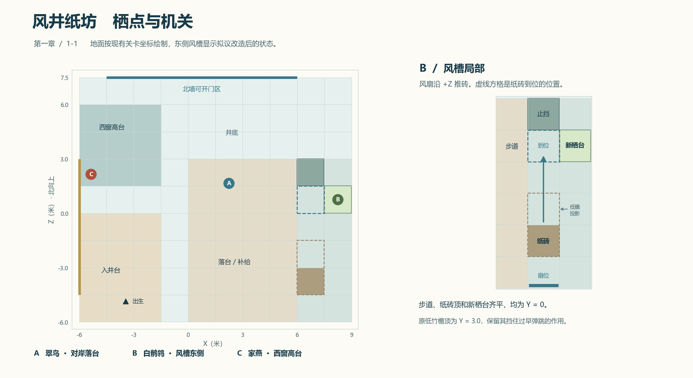

# 《百鸟卷》详细设计

首版覆盖主线第一章「青岚渡」的 1-1「风井纸坊」、三种可收录的小鸟，以及围绕这次收集的完整局外流程。本文中的坐标、交互尺寸和动效时长是首轮制作值。地形和运动参数已做静态核对，实机验收项目列在文末。

## 1　玩家的一次往返

玩家以折纸朱雀的第一人称站在井边，看见对岸一只蓝背小鸟低头望向井底。往白色井底和北墙开门，跃入井中，从墙门飞出，落在小鸟旁边。翠鸟展开橙色胸前的折面，振翅入卷。此时即使从暂停菜单离场，再打开大厅，也能在原先空着的纸折上找到它。

每关的目标是收齐关卡页展示的鸟位。1-1 由三种鸟组成，可以按任意顺序收集。主线开局时双门为空，朱雀持时空枪。青鸾和朱雀仍是两扇门的颜色和名字，玩家操控的朱雀单独作为角色展示。全卷计数按已收录**物种**统计，本关按已抵达的**栖点**统计。

## 2　风井纸坊的三处栖点

图中北为 +Z，坐标均为关卡根下的局部米数，1 格为 1.5 米。表内给出鸟脚在支撑面上的位置。模型转头、展翅和巡飞都围绕栖点编排，收集位置固定。

| 鸟与脚点 (X, Y, Z) | 观察线索 | 推荐路线及抵达反馈 |
|---|---|---|
| A　翠鸟　(2.25, 0, 1.65) | 对岸落台边的一抹石青。长喙低头探向井底，转身时露出橙色胸羽。 | 在井底朝上的白面和北墙朝南的白面开门，借下落速度飞上落台。翠鸟抬头、张翼入卷。落台补给另行判定，授予风扇、弹弹菇和纸翼。 |
| B　白鹡鸰　(8.25, 0, 0.75) | 槽端东侧的低栖台。白脸、墨颈和上下轻点的长尾在竹色背景前清晰可读。 | 在槽南端白壁安装风扇，沿 +Z 把活动纸砖推到止挡。纸砖补齐步道与栖台间的一格缺口。玩家走过砖面，白鹡鸰转身入卷。 |
| C　家燕　(−5.35, 4.50, 2.15) | 西窗高台上的叉尾剪影。燕子偶尔掠过窗前亮处，折返同一落点，巡飞约 2 秒。 | 在推到位的纸砖顶面装弹弹菇，起跳后展开纸翼，横越风井，滑向西窗。到栖点时即使燕子正在巡飞，它也会收翼回来迎接玩家。 |

**地形调整。** 以现有配置为底，新增一块固定竹砖，起始格 `(5, −1, 0)`、尺寸 `(1, 1, 1)`，作为 B 栖台。将原风槽止挡的起始格保留在 `(4, −1, 1)`，尺寸由 `(2, 1, 1)` 改为 `(1, 2, 1)`，腾出栖台北侧并挡住移动砖。移动砖的出生格仍是 `(4, −1, −3)`，到位后中心约为 `(6.75, −0.75, 0.75)`。原低竹檐继续覆盖推砖前的槽段，砖移出檐下后才有完整的起跳空间。

**路线核对。**

- A 从出生朝向向右约 27°，出生眼位到鸟胸的直线穿过空格。井底顶面为 −4.5 米，近似竖直下落 4.5 米时速度约 9.4 米/秒。北墙白区可容纳约 3.5 米高的出门中心。关卡美术给出视线引导，实际落点随入门速度和放门位置变化。
- B 的原低竹檐顶高 3 米，普通跳跃理论高度约 0.9 米。改造后，步道、到位砖顶和新栖台同为 0 米。按同高、四向相邻的地格核对，纸砖到位前步道与栖台断开，到位后可连续步行。熟练玩家用跳跃或传送门抄近路，同样记为收集。
- C 距起跳砖中心水平约 12.18 米，高差 4.5 米。竖直弹弹菇给予约 12.4 米/秒的相对出射速度，在当前重力下理论抬升约 7.84 米。天花底面为 9 米，还需实机检查朱雀头顶余量、风扇余推、横向加速和落台容错。首轮调栖点与落台边缘，保留现有手感基线。

地形与运动依据见 [第一关数据](../Assets/Resources/Levels/WindWell.asset)、[地格尺寸](../Assets/Scripts/PaperTerrain.cs)、[角色运动](../Assets/Scripts/WorkshopMotor.cs)和[装置受力](../Assets/Scripts/PaperDevice.cs)。

## 3　发现、收集与结算

| 时机 | 玩家看到或听到什么 | 判定和输入 |
|---|---|---|
| 可发现 | 鸟在世界中可见，通过传送门也能看见。未收鸟在朱雀周围 8 米内间隔约 6–9 秒鸣叫。开启「鸟鸣方位」时，屏边同步浮现一枚白羽约 1 秒。 | 同时有多只候选时，优先最近的一只。方向提示跟随鸟鸣，不显示距离或永久箭头。暂停时一起停止。 |
| 抵达 | 鸟转向朱雀，展翅。即便高速掠过也能收集。 | 以朱雀的物理胶囊到「脚点上方 0.25 米」的最近距离 ≤ 0.45 米为初值。再从朱雀胸口检测到鸟胸的实体遮挡，忽略角色自身和装饰羽片。朝向、使用的道具、是否落地均不作前提，无需按键。 |
| 入卷 | 摄像机和操控继续工作。鸟向上掠起，HUD 短显「翠鸟入卷　1/3」，约 2 秒收起。 | 首次命中时先提交收藏，再播放约 0.7 秒的归卷动效。确认提示使用独立位置，补给和安装提示排在下方。已收栖点停用收集判定，现场留一枚淡色折羽。 |
| 收到最后一只 | 先出现「本关已集齐　3/3」。安全落地后展开发现的三只鸟，主操作为「返回鸟卷」，次操作为「返回选关」。 | 第三条记录持久化成功即算通关。结算叠页等归卷反馈结束、连续着地约 0.2 秒且未暂停后再开。跌落时可在重生后安全落地结算。已经通过菜单主动离场时，局外直接显示集齐状态。 |
| 重访 | 选关显示「已集齐 · 重访」，关内折羽标出旧栖点，暂停页可返回选关。 | 从 3/3 入场进入自由重访。结算只响应本次新收齐的瞬间。西窗高台保留出口灯与标记，经过出口只作方位反馈。 |

**跨门与高速判定。** 在物理步内检测角色走过的短线段，避免速度高时跳过窄栖点。发生传送时把轨迹在入口、出口处分段，瞬移跨过的空间不参与收集。递归门摄像机只绘制鸟的模型。鸟的表现层避开装置瞄准射线及风扇、纸砖的碰撞层，使玩家仍能瞄准它背后的白面。

**重试与存档。** R 回本次检查点，T 从出生处重开；两者重置相应的关卡物理状态，已收鸟继续入卷。退出再进从出生点出发，已收鸟与本关计数从磁盘恢复，补给可再次领取。先收到家燕、最后回头找翠鸟，也走同一套结算流程。

## 4　局外页面与 HUD

界面以 1280 × 720 为布局基准。标题、设置和主要操作距安全区边缘至少 32 个布局单位，主要点击区至少 48 × 48。背景可以延伸，题字、按钮、鸟名及数值分别布局。超宽屏给窗景更多空间，窄屏先收小纸坊模型和题字，给收藏与操作保留位置。

| 页面 | 内容与操作 | 状态变化 |
|---|---|---|
| 大厅 | 左上「百鸟卷」，右上设置，右下唯一主线入口。画面左侧是收藏纸卷，右侧是折起的风井模型。模型的双门是局外展示。 | 0 种时只见芦苇空折、窗边的朱雀和主线入口。1–3 种时，每种鸟占独立栖纸，最近收录的一只默认居前。点任一只查看转身、鸟名、来源和一句辨识描述；点返回或 Esc 回到同一位置。 |
| 主线与选关 | 主线进入「第一章 · 青岚渡」，点击章节展开「1-1 风井纸坊」。模型标出井口、风槽和高窗。详情显示三枚鸟位及「出发」。返回逐级退回。 | 空鸟位只露出喙、长尾、叉尾的折痕。已收录的位置上色并显示鸟名。按钮下显示「本关 1/3」一类状态，避免与全卷物种总数混读。 |
| 战斗 HUD | 左上三横菜单，中间按当前持有道具显示准星，右下显示已拥有的道具和当前选中项。数字键 1–3、滚轮切换；纸翼跟随动作状态。 | 平时把正中央让给瞄准。入场、本次收集和暂停时显示鸟数；常规提示用白色，青鸾与朱雀色提示两扇门。关掉准星仍可收鸟，关掉方位提示仍可从外形和动作辨鸟。 |
| 暂停与设置 | 大厅齿轮、关内三横和 Esc 打开同一张月白折页，覆盖屏幕右侧约七成。左缘三签为「操作」「画面」「界面」。名称在左，值和控件右对齐，说明紧贴当前行。 | 大厅主操作为「完成」。关内页头显示「风井纸坊 · 已收 2/3」，页脚有「继续」和「返回选关」。Esc 优先关闭当前子层，再回到调用页面；从关内继续时恢复第一人称鼠标锁定。 |
| 结算 | 三只折鸟落进同一幅小景，标题「风井纸坊 · 鸟已齐」，各自保留名字和剪影特征。 | 「返回鸟卷」将大厅焦点落到最后收录的鸟；「返回选关」停留在本关的三枚彩图鸟位。 |

### 设置项与按键

| 签页 | 控件 |
|---|---|
| 操作 | 灵敏度为滑轨并显示数值，反转 Y 轴为开关，滑翔方式显示「按住空格 / 按一下切换」。固定键位表按移动、瞄准放置、切换、重试和暂停分组。 |
| 画面 | 视野角用滑轨，门中门层数用 0–4 的步进控件。保留垂直同步、帧率上限、阴影精度、显示模式和分辨率。阴影精度在大厅调整后进关生效。改显示模式或分辨率后，当前页显示「保留 / 还原」和 10 秒倒计时；超时或在未确认时离开页面，恢复此前的显示配置。 |
| 界面 | 准星、出口指引、操作提示沿用既有设置。新增「鸟鸣方位」，默认开，单独控制同步白羽。收集成功、保存失败、通关这些状态始终有文字反馈。每页「恢复本页默认」只影响本页设置。 |

鼠标悬停和键盘焦点共享同一条石青折边，Enter 确认，Esc 返回。勾选、页签和空鸟位同时以形状表达状态。暂停耗时不推进鸟的行为与收集动画，显示配置的确认倒计时使用真实时间。

## 5　美术、光照与动效交付

- **折纸造型。** 三种鸟各做一个可从正、侧、背面辨认的立体模型，供关卡、门中视图和收藏近观共用。翠鸟靠长喙和饱满胸腹，白鹡鸰靠细长身体与点尾，家燕靠镰形翼和叉尾。翼和尾沿建模折线展开，翻面露出较浅纸色。胖朱雀的短喙、头冠和圆肚要与三只收藏鸟拉开轮廓差异。
- **第一眼的可读性。** A 的首轮站高取 0.38–0.42 米。出生点到 A 约 8.65 米，按默认 70° 垂直视野估算，在 720p 下站姿约占二十余像素。验收时用真实出生镜头看能否先辨认长喙和蓝背；若鸟与背景混在一起，先调整朝向和背后的明度。大厅近观用独立构图展示同一模型。
- **岩彩与透亮感。** 以月白受光面、浅青反射光、淡紫背光面组织空间。首轮色样采用月白 `#F5F4ED`、淡石青 `#BFDDE2`、灰紫 `#C9C5DD`、青鸾 `#327F96`、朱砂 `#BE503E` 和深墨字 `#243841`。矿物颗粒集中在翠鸟背羽、窗纸透色和色面交界。以 HUD 开启时仍能辨认白面、门沿与鸟胸为曝光验收依据。
- **分层与动作。** 远景窗光、纸坊模型、收藏区鸟模、uGUI 文字和按钮分开制作。鸟只需待机、转身和归卷三组基本动作，家燕另配固定巡飞路径。风扇转动、翼面翻折和窗棂投影提供空间深度。翻页 0.25–0.35 秒，按钮在翻页结束时就位，快速返回可打断过渡。
- **音画线索。** 每种鸟至少一条可区分的短鸣，统一控制最密触发频率。第一人称视点作为唯一监听位置；递归门视图共享视觉模型，避免重复播放鸣叫。静音时仍能靠栖点动作及白羽完成全程。

## 6　对接现有 Unity 工程

| 所有者 | 建议改动与职责 |
|---|---|
| 关卡数据 | 扩展现有 `WorkshopLevel`，加入稳定的关卡 ID 与栖点列表。每个栖点记录稳定 ID、鸟种引用、本地脚点、朝向和可选巡飞路径。以关卡数据校验 ID 唯一、引用有效及至少一个目标；编辑器绘制栖点、收集半径和落脚面。 |
| 鸟种资产 | 每种资产持有物种 ID、中名、短描述、模型、鸟位图、动作与鸣声。大厅、选关和关内从同一资产读外观。首版物种 ID 可用 `kingfisher`、`white-wagtail`、`barn-swallow`。同种鸟出现在另一关时，全卷已有记录，本关仍可收录新栖点。 |
| 关内会话 | `FerryPuzzle` 在首次构建关卡时创建「鸟群」父节点，开局按存档刷新表现。沿用 `WorkshopMotor` 的刚体和着地信息、现有穿门事件/结果与补给流程。收录事件分别通知 HUD 和收藏记录。把原来的「进入出口区域即完成」接线移到「本次集齐并安全落地」。 |
| 局外与设置 | `Campaign` 管导航、会话和结算快照，`WorkshopHud` 管收鸟提示，`SettingsPanel` 继续由 `GameSettings.Items` 生成设置行。默认 `Campaign.unity` 保存第一屏布局和可编辑的展示锚点，编辑态即可检查空卷。收录模型按存档生成，主界面与对局共用同一份收藏状态。 |
| 收藏存档 | 建议在 `Application.persistentDataPath` 独立保存 `bird-collection.json`，包含格式版本、按首次收录排序的「关卡 ID / 栖点 ID / 物种 ID」记录。用前两项幂等去重，关卡完成和全卷种数均从集合推导。缺少收藏文件的老玩家从空卷开始，沿用原 `settings.json`；物种或栖点改名只改显示文本。 |

存档由单一写入者先写同目录临时文件，再替换正式文件并保留上一有效版。读取损坏时尝试备份。写入失败保留待写记录，明确显示「收藏待保存」并在后续手动离场前重试；只有写入成功才显示「已入卷」。恢复失败时提供留在当前会话重试的选择。新关卡发布后，暂时找不到的旧 ID 要保留，在当前关卡计数时只匹配有效栖点。

## 7　制作顺序与验收

1. **先打通一只翠鸟。** 用同一个折纸模型完成空卷大厅 → 第一章 → 第一关 → A 入卷 → 主动返回 → 点击大厅翠鸟。关闭并重启游戏，仍能看到翠鸟和本关 1/3。
2. **补齐三条路线。** 按图改风槽，加入 B、C。用真实输入验证自由落体穿门、风推纸砖搭桥、菌盖弹起接滑翔；经历失败后仍能继续。用另一种次序和替代解法再收齐一次。
3. **完成局外与设置表现。** 接入页签、三种鸟姿态、递归门中的显示、音画提示、存档异常提示和结算。验收 1280 × 720、1920 × 1080、21:9 及 4:3，并检查鼠标和键盘焦点顺序。

| 情形 | 通过条件 |
|---|---|
| 在门中看见鸟、隔着薄墙贴近鸟、道具或活动砖经过鸟 | 均能正确区分可见与抵达；收藏记录不变。角色实际穿出门后掠过栖点，恰好入卷一次。 |
| 出生和补给 | 开局没有预放传送门；A 在默认视角转头范围内；进入补给区即获得装备和检查点，任何鸟的收集顺序都不影响发放。 |
| 推砖与滑翔 | 风扇把 2 千克纸砖推到止挡后可平走至 B。纸砖顶能放弹弹菇，沿推荐线路可抵达 C。逐项记录搭桥间隙、窗边碰撞与落点容错，再敲定摆位。 |
| 在 1/3 时 R、T、退出、重进或重启应用 | 收藏始终为 1/3。重复抵达 A 不增加全卷计数，不再次播报首次入卷。 |
| 最后一只在空中取得，随后跌落、暂停或直接离场 | 首次收齐已保存。空中与暂停中不强切镜头；恢复并安全落地只结算一次；主动返回后大厅和选关都是 3/3。 |
| 单独关闭准星、方位提示或操作提示；两门递归可见 | 相应开关分别生效；三个栖点都可收集，门中可看见鸟，HUD 和鸟鸣只出现一份。 |
| 初装、旧设置、收藏文件损坏或写入失败 | 初装为空卷，旧设置仍可用；损坏可读备份；保存失败有反馈与重试，不虚报永久进度。 |

### 首版实现与实测

- Unity 6000.6.10f1 Play Mode 中，朱雀从井边自然落下，经井底门从北墙飞出，在对岸约 `(3.70, 0.41, 1.15)` 着地。风扇将纸砖推至止挡后可以步行收白鹡鸰，在同一块砖上放弹弹菇并滑翔可抵达西窗家燕。测试使用关卡实际的射线、刚体、装置与固定物理步。
- 测试经由游戏输入系统触发了开门、T 重开和 Esc 暂停／继续。控件射线覆盖大厅、设置、选关、赏鸟和结算。大厅至选关的往返另在 1280 × 720、1920 × 1080、2520 × 1080 与 1024 × 768 检查了按钮可达性。
- 正序收齐、换序收齐、空中收齐后暂停再落地、重访、1/3 主动离场、3/3 关闭再启动均通过。薄墙遮挡与穿门瞬移跨过栖点不会误收。独立存档测试覆盖重复收录、主档损坏读取备份和写入失败后的重试。
- 两张图取自 Unity Game 视图。[收录翠鸟后的大厅](visual-review/bainiao-kingfisher.png) · [第一关出生视角](visual-review/bainiao-first-person.png)
